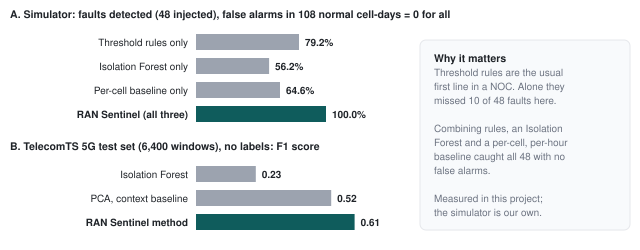
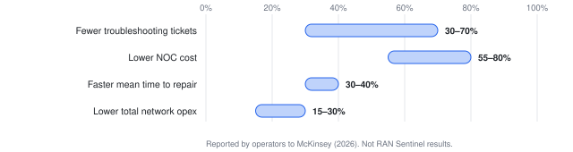
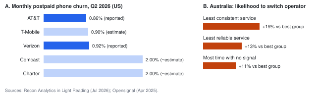
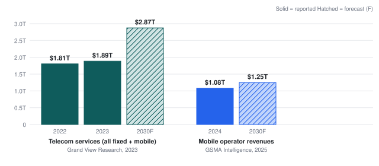
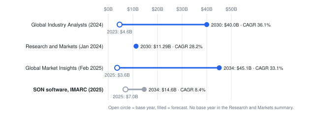
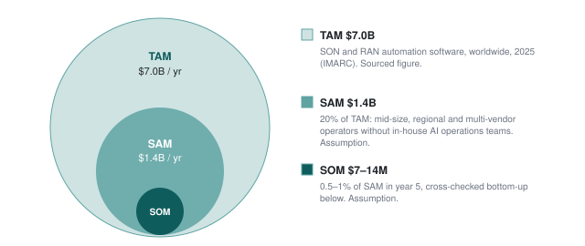
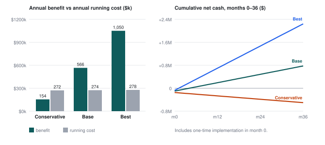

# RAN Sentinel

An AI co-engineer for mobile networks, built on Meta's Muse models.

RAN Sentinel watches a cluster of LTE cells in Seattle, WA (US bands B66, B2 and B71) and spots a degrading cell. Muse Spark agents investigate it with read-only tools and propose a fix. Fixed safety rules and a digital twin check that fix before anyone sees it. The recommendation then goes to the right department. When a configuration change is approved, it is sent as an Open M-Plane change package with automatic rollback, and the cell is watched until it recovers. Customers of the fictional operator **Northstar Connect** see only confirmed, plain-language updates.

Everything runs on a **simulated** network. Nothing here connects to a real operator.

## Highlights

- **Verified investigation.** Every diagnosis passes a verifier the agents cannot skip. The agent pauses to ask a field engineer when the data cannot settle a cause, keeps a living plan, works one tool per turn, resumes from its last step after an API failure, and an engineer signs off the root cause. The design follows the patterns in Meta's [legal-agent workshop](https://github.com/meta-models/legal-agent-workshop) ([details](docs/VERIFIED_INVESTIGATION.md)).
- **Six Meta models, each with one job:** Muse Spark 1.3, 1.2 and 1.1, Muse Wonder 1.0, SAM 3.1 and Muse Voice Transcribe 1.0, plus Open M-Plane and Maveric.
- **Safety first:** nine fixed safety rules, a digital twin, five bounded agent loops, and NETCONF confirmed-commit with automatic rollback.
- **Detection benchmarked** on the open TelecomTS dataset.
- **Customer side:** plain-language network updates, a hands-free **voice agent** that operates the app ([details](docs/VOICE_AGENT.md)), and a help center with support requests.
- **Demo controls** for live fault injection, plus red-team, twin outage, diagnostics outage and model outage switches that show every safety path. A guided walkthrough is in [DEMO.md](DEMO.md).
- **177 automated tests.** The code is MIT-licensed ([LICENSE](LICENSE)).

What's built for the US market:
- **FCC Part 4 outage check** (47 CFR 4.9(e)). It tracks user-minutes for every outage and, when a wireless outage passes 30 minutes and 900,000 user-minutes, opens a Regulatory Compliance ticket with the 120-minute, 72-hour and 30-day deadlines. Set `FCC_USERS_PER_SITE` in `.env`. This is decision support, not legal advice.
- **Real neighborhoods and ZIP codes.** Customers can check a ZIP code, and the assistant understands one too ("Is there an issue in 98101?").
- **Times in Pacific time.**

## Why it matters: industry impact and business case

Mobile networks are run by small teams watching very large numbers of cells. When one cell degrades, an engineer still gathers the evidence by hand, decides the cause and pushes a configuration change, and a wrong change can take down far more than the cell it was meant to fix. RAN Sentinel automates the gathering and the first diagnosis, proves every change safe with fixed rules and an RF twin, and leaves the decision with the engineer.

| | | |
|---|---|---|
| **$1.08T** mobile operator revenue in 2024 ([GSMA](https://gsma.com/solutions-and-impact/connectivity-for-good/mobile-economy/wp-content/uploads/2025/02/ME_2025_Infographic.pdf)) | **15–30%** lower network opex that operators report from AI operations ([McKinsey, 2026](https://www.mckinsey.com/industries/technology-media-and-telecommunications/our-insights/issue-brief-ai-driven-telecom-networks)) | **$7.0B** SON / RAN automation software market in 2025 ([IMARC](https://imarcgroup.com/self-organizing-network-market)) |
| **92 million** calls blocked by one AT&T configuration error, Feb 2024 ([FCC via Fierce](https://fierce-network.com/wireless/fcc-reports-atts-nationwide-outage-february)) | **48 / 48** simulated faults detected, 0 false alarms *(measured here)* | **11 / 11** incidents diagnosed correctly by live Muse Spark agents *(measured here)* |

### The problems it addresses

| Industry problem | What operators do today | What RAN Sentinel does | Evidence |
|---|---|---|---|
| Manual fault triage | Engineer correlates dashboards, alarms and config for each cell | Three detectors; Muse Spark agents gather cited evidence with read-only tools; a verifier checks every number | 11/11 correct live, no wrong diagnosis verified |
| Missed gradual faults | Static threshold alarms | Rules + Isolation Forest + per-cell, per-hour baseline | 100% vs 79% detection (chart below) |
| Risky configuration changes | Manual procedure and peer review; AT&T 2024 and Optus 2023 outages began with a change | Nine fixed safety rules, Maveric what-if, mandatory approval, confirmed-commit rollback | Built and tested |
| Outage cost and reporting | User-minutes compiled after the event | Live FCC Part 4 tracking with the 120-minute, 72-hour and 30-day deadlines | Built and tested |
| Customers left uninformed | Generic status pages and care calls | Confirmed plain-language updates, recovery estimate, reports straight into the NOC, voice agent | Built; impact to be measured in a pilot |
| Small operators can't build AI ops | Vendor-tied SON or nothing | Vendor-neutral, open interfaces (Open M-Plane, Maveric), laptop-scale models, no labels needed | Design choice |

### Compared with the methods operators use today



*Measured in this project. Panel A: our 36-cell simulator (48 injected faults). Panel B: the open TelecomTS 5G dataset, with the detector chosen on a validation split, never on test.*



*Industry figures from McKinsey (2026). They show the size of the prize, not RAN Sentinel results.*

### Why network quality is a business problem



US postpaid phone churn is 0.86–0.92% a month at the national carriers ([Recon Analytics, Jul 2026](https://www.lightreading.com/wireless/each-carrier-nailed-its-q2-plan-but-buried-the-number-that-shows-the-cost)), and users with the least consistent service are 19% more likely to switch ([Opensignal](https://insights.opensignal.com/2025/04/28/retention-starts-with-reception-how-mobile-network-experience-drives-churn-in-australia/dt)). Heavy Reading's survey of 54 operators put outage costs at 1–5% of revenue (2016, the latest public survey we found).

### Market size





Research firms disagree widely on "AI in telecom" ($11–45B at the end of their forecasts) because they define it differently. We size the opportunity on the narrower, more conservative SON software market.



*TAM is sourced. SAM (20% of TAM: mid-size, regional and multi-vendor operators without in-house AI teams) and SOM are our assumptions. Bottom-up check: 40 operators × 13,500 cells × $1.50 per cell per month = $9.7M a year.*

### Return on investment for an operator (illustrative)



| Per year, carrier with 13,500 cells | Conservative | Base | Best |
|---|---:|---:|---:|
| Running cost (subscription, hosting, model API) | $271,562 | $274,300 | $277,950 |
| Engineer time saved | $153,984 | $410,625 | $739,125 |
| Retention value | $0 | $155,520 | $311,040 |
| **Net annual benefit** | **−$117,578** | **$291,845** | **$772,215** |
| Payback | does not pay back | 4.1 months | 1.2 months |
| 3-year ROI | −52% | +84% | +247% |

Every input is an assumption to be replaced with pilot data (incidents per day, time saved, churn effect, implementation cost). The conservative case does not pay back: the product makes sense where incident volume is high enough, and a pilot has to establish that. Full assumptions and formulas are in the PDF.

### Where it fits

RAN Sentinel is not a replacement for a vendor's SON or an operator's OSS. Large vendors and operators already ship agentic RAN tools ([Ericsson](https://www.ericsson.com/en/press-releases/2026/2/ericsson-launches-agentic-rapp-as-a-service-on-aws-to-accelerate-autonomous-networks-transformation), [Nokia MantaRay](https://www.globenewswire.com/news-release/2025/11/25/3194000/0/en/Nokia-introduces-MantaRay-SON-to-NTT-DOCOMO-s-multi-vendor-5G-network.html), [Deutsche Telekom](https://www.telekom.com/en/newsroom/latest-updates/media-information/2025/2/agentic-ai-for-autonomous-networks)), tied to their own stacks or not for sale. RAN Sentinel is a vendor-neutral co-engineer for the operators that cannot build their own AI operations: regional and rural carriers and mid-size operators in multi-vendor networks, including emerging markets. Its safety layer is code, not a model.

**The full research chapter**, with 25 sources, the customer-experience analysis, the competitor comparison, a four-phase rollout plan and the risks, is Part A of the [technical documentation PDF](docs/RAN_Sentinel_Technical_Documentation.pdf).

## Documentation

| Document | What it covers |
|---|---|
| [Complete user manual (PDF)](docs/PROJECT_COMPLETE_USER_MANUAL.pdf) | architecture, installation, a guide to every feature with annotated screenshots, the testing guide with real results, a 5 to 10 minute guided demo, troubleshooting |
| [Technical documentation (PDF)](docs/RAN_Sentinel_Technical_Documentation.pdf) | Part A: industry problems, market size (TAM/SAM/SOM), customer experience, ROI scenarios, competitors and rollout, with sources; Part B: the technical manual |
| [System architecture](docs/SYSTEM_ARCHITECTURE.md) | roles, components, runtime model, incident lifecycle, agent loop, data flow, tech stack |
| [AI agents and models](docs/AI_AGENTS_AND_MODELS.md) | every agent, its model and fallback, tools, limits, what is deterministic |
| [Live-update architecture](docs/LIVE_UPDATE_ARCHITECTURE.md) | polling, in-place page patching, request handling, the refresh fix |
| [API and database](docs/API_AND_DATABASE.md) | every route, request and response, the SQLite schema |
| [Setup and deployment](docs/SETUP_AND_DEPLOYMENT.md) | install, `.env` settings, health checks, troubleshooting, verification checklist |
| [Verified investigation](docs/VERIFIED_INVESTIGATION.md) | the verifier, field-evidence pause, living plan, checkpoints and resume, sign-off, and how each maps to Meta's legal-agent workshop |
| [Maveric RF twin](docs/MAVERIC_TWIN.md) | the what-if on Meta's Maveric RADP: setup with Docker, what it sends, measured accuracy |
| [Customer voice agent](docs/VOICE_AGENT.md) | the voice pipeline (Muse Voice Transcribe, Muse Spark, Gemini TTS), its tools, safety and speed |
| [Security and access control](docs/SECURITY_AND_ACCESS_CONTROL.md) | sign-in, roles, customer data limits, secrets, known gaps |
| [Implementation and test report](docs/IMPLEMENTATION_AND_TEST_REPORT.md) | the live-refresh fix with before/after numbers, test results, change history |

## Run it (Windows)

```powershell
git clone https://github.com/AKMaasif/Meta-Ai-Global-Hackathon-Ran-Sentinel-.git
cd Meta-Ai-Global-Hackathon-Ran-Sentinel-
```

You need Python 3.10 or newer. The quickest way is to double-click **`start.bat`**. On the first run it creates the virtual environment, installs the requirements and copies `.env.example` to `.env`; then it starts the server and opens the console in your browser. Put your key in `.env` before the next start.

Or step by step:

```powershell
py -m venv .venv
.venv\Scripts\activate
pip install -r requirements.txt
copy .env.example .env
notepad .env          # paste your Meta key after MODEL_API_KEY= (and, for the voice agent, a Gemini key after GOOGLE_API_KEY=)
py scripts\check_meta.py   # checks every Meta model the app uses (chat, tools, JSON, vision, SAM, voice)
py scripts\check_field_files.py # checks Muse Spark reads field files (CSV, PDF, DOCX, TXT, photo)
py scripts\audit_agents.py # runs every AI agent live through the app code and prints PASS / FALLBACK / FAIL
py run.py
```

Then open:

- Operations console: http://127.0.0.1:8000/ops/ (sign in with `OPS_EMAIL` / `OPS_PASSWORD` from `.env`)
- Northstar Connect customer app: http://127.0.0.1:8000/connect/ (`CUSTOMER_EMAIL` / `CUSTOMER_PASSWORD`)

**Where the API key goes:** `.env` in the project folder, on the line `MODEL_API_KEY=...`. That file is listed in `.gitignore`, so it is never committed. Don't put the key in any `.py` or `.js` file.

Without a key the app still runs, but the agents use an **offline rules engine**. The console then shows "Offline rules engine" everywhere, so those results can't be mistaken for Meta-powered ones.

## The operations console

The console follows the layout of a network operations (OSS) tool: a top bar with global search and live alarm counters by severity, a module rail, one work area and a status bar.

| Module | What it shows |
|---|---|
| **Monitor · Network overview** | KPI tiles with trends, the cluster map, the incident work queue, network health, AI activity and a live model-call feed |
| **Monitor · Alarm monitor** | Every alarm with X.733-style fields (severity, event type, probable cause, managed object, linked incident); filter and acknowledge |
| **Monitor · Cell explorer** | Network tree by site and band; for each cell, KPI charts against limits, alarms, M-Plane radio config and detector scores |
| **Operate · Incidents** | Tabbed incident workspace: fact bar, workflow timeline, diagnosis with its verification, plans and safety checks, evidence, field photos, an agent console with every model call, report and ledger. Beside it: the live investigation plan, any field-evidence request and the decision panel |
| **Operate · Approvals** | One card per team with its queue, and the decisions waiting on each |
| **Assure · Safety ledger** | The Evidence-to-Action Safety Ledger and the Muse Wonder shift handover |
| **Assure · Model card** | Models, fallbacks and the measured accuracy |
| **Customer support** | Help requests from the customer app: filter, search, reply, set status and priority |

The status bar shows the telemetry window, AI calls and average latency, the twin and the M-Plane link. Search by incident ID, cell ID, site name or ZIP code.

## The customer app (Northstar Connect)

A carrier self-service app with the usual pages: **Home**, **Network**, **Account** (lines, plan, settings, places), **Bill** (balance, items, history), **Help**, **Notifications** and **Shop**. On top of that, an AI care layer works for the customer:

- **Proactive alerts** for the places they care about (Home, Work, Gym). The customer hears about a problem before they notice it, then gets progress updates and a "back to normal" message.
- **Network transparency:** a plain-language cause, what they may notice, a six-step repair tracker, and a **recovery-time estimate** with a confidence level.
- **Personal suggestions** that fit the problem and their settings (Wi-Fi Calling, Data Saver, texting instead of calling, device checks when the network is fine).
- **Outage credits** offered automatically by a fixed rule (30+ minutes down at one of their places earns a $5 credit).
- **Problem reports that reach engineers:** if a report matches an open repair, it is added to that incident as evidence for the NOC; if not, the app walks the customer through device checks.
- **Care Concierge** on Muse Spark 1.3 with tool calls. Its tools see only this customer's account and published network updates. It can only *propose* a change; the customer taps Confirm.

| Layer | Runs on | Job |
|---|---|---|
| 1 Listen | Muse Voice Transcribe 1.0 | Spoken questions to text |
| 2 Care Concierge | Muse Spark 1.3 (1.2, 1.1 backup) | Plans the answer and calls customer-scoped tools |
| 3 Network Explainer | Muse Spark 1.3 | Customer updates written from engineer-approved facts |
| 4 Recovery Estimator | Fixed rules | Estimate from repair stage and typical repair times |
| 5 Personal Advisor | Fixed rules | Suggestions for the customer's situation |
| 6 Guardrails | Fixed rules | Blocks internal details, applies the credit rule, needs the customer's confirmation |

**Voice agent.** The "Ask" orb opens a hands-free assistant. The customer speaks; Muse Voice Transcribe turns it into text, the
Care Concierge on Muse Spark answers and operates the app (connection tests, opening pages, reports), and Gemini TTS speaks the
answer sentence by sentence. Changes still need a spoken "yes" in a later turn or a tap on Confirm. See [docs/VOICE_AGENT.md](docs/VOICE_AGENT.md).

**Help and support.** The Help tab is a help center: search across 17 articles (each with steps and a real screenshot of the app), browse by topic, and expand the frequently asked questions. If an article doesn't solve it, **Contact support** opens a form (name, email, topic, subject, description) that is checked in the browser and again on the server. Each request gets an ID such as `CS-100001`, is saved in SQLite and appears under **My requests** with its status and the full conversation. The customer can reply, which reopens a resolved request, or close it. A dot on the Help tab shows when support has answered. Customers only ever see their own requests.

In the operations console, **Customer support** is the agent's desk: filter by status and topic, search by ID, name, email or message text, open a request to read the conversation and the customer's other requests, reply, and change status or priority. Every change is written into the conversation. The code is in `backend/app/support.py`, and the routes are listed in [API and database](docs/API_AND_DATABASE.md#5-help-and-support).

The subscriber, account and bill are fictional demo data, and no payment is taken. No email is sent for support requests; replies appear in the app only. The code is in `backend/app/care.py` and `frontend/connect/`.

## Maps and signal quality

Both apps use an interactive map of the United States: **Leaflet 1.9.4** with **US state boundaries** from the US Census Bureau (us-atlas 3.0.1, 1:10m). Both are bundled in `frontend/shared/vendor/`, so the outline works offline. When the PC is online, a light street basemap (© OpenStreetMap contributors, © CARTO) loads underneath. If the tiles can't load, the map says so and keeps the state outlines.

- **Operations console, Cluster map:** opens on the whole US, then flies to Seattle. Zoomed out, the cluster is one marker with its cell and incident counts. Zoomed in, you see the 12 sites and 36 sector wedges, coloured by state, with modelled coverage circles. Click a site for its cells, band, azimuth, PRB load, SINR, power and tilt; click a sector to select that cell. Layers can be switched on and off. Zoom and position survive the auto-refresh, which patches the page in place instead of rebuilding it ([details](docs/LIVE_UPDATE_ARCHITECTURE.md)).
- **Customer app, Network page:** only towers within 3 km of the customer's saved place. The server filters them (`GET /api/care/map`) and never sends cell IDs, power or tilt. Each tower is connected, available, problem or unavailable; problem and unavailable appear only once engineers publish an update. The customer can drag the test phone up to 1.5 km and see the signal change.
- **Signal card:** RSRP, RSRQ, SINR, latency and packet loss with a 12-window history, the serving tower, technology and band, tower changes and stability. Each metric has its own scale (for example RSRP: Excellent at -80 dBm or better, Good to -90, Fair to -100, Poor to -124, below that Disconnected). The overall rating is the worst measured metric, and the card names which metric sets it. A missing value shows as Unknown, never as a guess.
- **Signal intelligence:** Muse Spark explains the reading in three lists: *confirmed* (what the numbers show), *probable* (causes the facts support) and *not verified*. The answer is rejected if it uses a number that isn't in the measurements or mentions internal details. Without a key, a fixed template gives the same structure.

**Where the numbers come from:** the sites are fictional but placed on the simulator's km grid, which is anchored at Downtown Seattle, so each one sits near the neighbourhood it is named after. Coverage and the phone's readings come from a radio model of the simulated network (`backend/app/radio.py`): 3GPP TR 36.942 urban path loss, a 3GPP-style sector antenna pattern, each cell's running power and tilt, and its live simulated KPIs. The serving tower is the strongest modelled signal, not the nearest tower. Every screen labels this as a simulated test phone, not the customer's real phone. The browser's own connection info (`navigator.connection`) is shown separately and marked as not cellular.

## Demo: create a problem live

Open **Demo controls** from the module rail (it opens as a drawer beside any page):

1. Pick a cell (or click a sector on the map) and a problem:
   - **Capacity surge:** an event crowd arrives. Fix: lower transmit power so users move to a neighbour. Goes to RAN Optimisation.
   - **Overshoot:** a bad config push set the tilt too low. Fix: restore the tilt. Goes to RAN Optimisation.
   - **External interference:** no config fix exists. Goes to RF Engineering to find the source.
   - **Hardware fault (VSWR):** goes to Field Operations for a site visit, and customers are told a repair is underway.
   - **KPI data dropout:** the agent re-polls the collector by itself. Severity 1 fixes itself; otherwise it goes to the NOC Data Platform team.
2. Click **Create problem**. Within about two telemetry windows the detector opens an incident and the agents start on their own.
3. Open the incident and approve, reject, or ask for more information. For field tickets, click **Mark fixed** after "dispatch".
4. Optional switches:
   - **Red-team the first plan:** forces an aggressive first draft so you can show the safety rules blocking it.
   - **Twin outage:** shows the "not simulated" error path.
   - **Diagnostics outage:** the diagnostic checks time out, so the agent cannot settle the cause from data. It pauses and asks a field engineer; type what was found (for example "spectrum analyser shows a booster east of the site") and it resumes.
   - **Meta API: primary model down / all models down:** shows the model fallback and the escalation path. With a key, an interrupted investigation resumes from its saved step once the API is back.

## How it works

| Layer | What it does | AI? |
|---|---|---|
| 1 Data | Range and missing-data checks; bad windows are quarantined | No |
| 2 Detection | Threshold baseline + Isolation Forest, 2-window confirmation, related-alert grouping | No (ML) |
| 3 Orchestrator | State machine, budgets (8 tool calls, 2 evidence rounds, 3 verifier refusals, 2 plan retries, 1 reopen), checkpoints and resume, field-evidence pause, escalation | No |
| 4 Agents | Investigator (tool calls), Root-Cause Analyst, Remediation Planner, Plan Reviewer (second opinion on a different model), Customer Comms, Customer Assistant, Incident Reporter, Escalation Briefer, Shift Handover, Field Photo Analyst, voice notes | Muse Spark 1.3 / 1.2 / 1.1, Muse Wonder 1.0, SAM 3.1, Muse Voice Transcribe 1.0 (table below) |
| 5 Safety | Diagnosis verifier (hidden playbook, fact lookup, root-cause rules; claims check on a second model) + 9 deterministic plan rules + twin what-if + department approval + M-Plane dry run + confirmed-commit | Mostly no |
| 6 Surfaces | Evidence-to-Action Safety Ledger, ops console, customer app | No |

The five loops, each with a limit:

1. **Evidence:** the analyst asks for more read-only checks (up to 2 rounds). If the cause is still unclear, the agent asks a field engineer once.
2. **Output repair:** agent JSON is schema- and citation-checked, with 1 repair try.
3. **Verification:** a refused diagnosis gets the missing evidence and the verifier's reasons (up to 3 refusals, then a person).
4. **Plan revision:** validator reasons go back to the planner (up to 2 retries).
5. **Recovery:** after a change, the cell is watched. If it recovers, the commit is confirmed. If not, the change is rolled back and the investigation reopens once.

Error paths: bad data, duplicate or related alerts, Meta API errors and timeouts, tool errors, invalid model output, budget exhaustion, unsafe plans, twin unavailable, failed M-Plane dry run, unconfirmed commits (the radio reverts by itself), customer text leaking internal details, and prompt injection in data. The full diagram is in `docs/workflow.mmd`.

## Which Meta model does what

Each model has one job where it helps. None is there just to be listed.

| Model | Used for | Why this model | If it is unavailable |
|---|---|---|---|
| muse-spark-1.3 | Investigator, Analyst, Planner, Customer Comms, Customer Assistant, Incident Reporter, photo reading | Tool calls and JSON output passed on your key | falls back to 1.2, then 1.1 |
| muse-spark-1.2 | Plan Reviewer; Claims Checker in the verifier; fallback for everything | A different model gives a more independent second opinion | falls back to 1.3, then 1.1 |
| muse-spark-1.1 | Last-resort tier | One more chance before an incident escalates to a person | escalate to the NOC Shift Lead |
| muse-wonder-1.0 | Escalation Briefer; Shift Handover | The hardest cases get the strongest model. The handover reads every incident and the whole ledger, which needs the 1M-token context | Muse Spark 1.3, then a template |
| sam-3.1 | Field Photo Analyst: boxes antennas, cables and connectors in a technician's site photo | Segmentation is SAM's job; Spark then reads the photo with those boxes | photo stored without analysis |
| muse-voice-transcribe-1.0 | Dictated decision notes (ops); spoken questions (customers) | Engineers on a mast or in a van have their hands full. Cell IDs and site names are sent as keyword hints | type instead |

The voice and photo features are advisory only. A dictated note can highlight a decision button, but it never clicks it. A photo adds evidence and can raise a "does not match the diagnosis" warning, but it never changes an incident.

**On the key but not used:**
- **muse-image-1.0:** a generated picture is not evidence and could be mistaken for a real site photo.
- **The -contributor variants:** they cost less, but Meta may train on what is sent, and incidents and customer questions can hold sensitive data. You can opt in for the customer assistant only, with `ASSISTANT_MODEL=muse-spark-1.3-contributor`.

`py scripts\check_meta.py` tests each of these models through the same code the app uses. The checks cover chat, tool calls, JSON, vision with an image, SAM with a generated test image, and transcription with a generated WAV. Add `--image site.jpg --audio note.wav` to try your own photo and recording.

## Models and measured accuracy

The live detector has three parts, and any one of them can raise an alert. An alert fires after 2 consecutive 15-minute windows.
- **Threshold rules:** seven limits an engineer would set.
- **Isolation Forest:** learns normal traffic.
- **Cell baseline:** compares each KPI with what is normal for that cell at that hour, scored with Mahalanobis distance.

None of them needs labelled faults. The **Model card** page in the console shows all results.

**Open dataset: [TelecomTS](https://github.com/Ali-maatouk/TelecomTS)** (MIT licence, ICML 2026): 32,000 labelled 5G windows covering 11 anomaly types. The split was 80/20 train/test. The unsupervised detector was chosen on a validation split taken from training data, never on test. Thresholds were set for a 1% false-alarm rate.

| Detector (TelecomTS test set) | Labels needed | F1 | Recall | ROC-AUC | False alarms |
|---|---|---|---|---|---|
| Isolation Forest | No | 0.23 | 0.16 | 0.76 | 0.9% |
| PCA reconstruction, context baseline | No | 0.52 | 0.47 | 0.91 | 1.3% |
| **Mahalanobis, context baseline (selected)** | No | **0.61** | **0.59** | **0.92** | 1.4% |
| Gradient-boosted trees (reference) | Yes | 0.97 | 0.94 | 1.00 | 0.0% |

Root-cause classification with labels scored 99.0% accuracy across the 10 synthetic types, and 98.9% after mapping to RAN Sentinel's causes. Labels make a large difference, so the roadmap turns incidents that engineers confirm in the ledger into training labels. The supervised scores are likely optimistic, because TelecomTS anomalies were recorded in separate sessions from normal traffic. Jamming is the hardest type to detect without labels: only 15% was caught.

To reproduce:

```powershell
pip install huggingface_hub
py scripts\benchmark_telecomts.py --export-features data\telecomts_features.csv.gz   # downloads 1.1 GB once
py scripts\benchmark_telecomts.py --features data\telecomts_features.csv.gz          # fast re-runs
```

| Simulator benchmark (48 injected faults) | Detected | False alarms in 108 normal cell-days |
|---|---|---|
| Threshold rules only | 79.2% | 0 |
| Isolation Forest only | 56.2% | 0 |
| Cell baseline only | 64.6% | 0 |
| **All three (shipped)** | **100%** | **0** |

After the full investigation, the correct root cause ranked first in 97.9% of simulator runs. Re-run this benchmark with `py scripts\benchmark_simulator.py`.

`py scripts\eval_investigation.py` scores the whole verified investigation against the injected faults (add `--live` for the Muse Spark agents). Offline: 11 of 11 incidents correct and verified at severity 2, 12 of 12 at severity 1, and no wrong diagnosis passed the verifier. Live on Muse Spark (2026-10-31, severity 2): 11 of 11 diagnosed correctly, `wrong_but_verified` 0; 8 verified, and the 3 overshoot cases paused to ask the field before running the data checks. The investigator now has to use the data tools before it may ask the field.

## Honest limits

- **Simulated network:** 36 cells in Seattle with a small, explainable KPI model. Northstar Connect is fictional.
- **TelecomTS vs live data:** TelecomTS validates the detection method on real 5G testbed telemetry: per-UE KPIs every 100 ms. The live demo runs on simulated cell-level KPIs every 15 minutes, because no open dataset offers a cell cluster with config control.
- **Twin:** with Maveric running, coverage comes from Maveric's RF twin trained on modelled (not drive-test) RSRP; load still comes from the simulator copy. Without it, the labelled fallback twin does both.
- **Open M-Plane:** XML uses simplified, O-RAN-style element names and goes to an in-process simulated radio unit, not real hardware or the open-mplane C stack.
- **Meta models:** every model passed `check_meta.py` on a real key (2026-10-28). Voice was checked with a test tone only, so transcription of real speech is not yet measured; try `--audio` with a recorded note.
- **Maps:** the street basemap needs internet; state outlines are offline. Towers and coverage are modelled, not surveyed.
- **Agent audit:** `scripts/audit_agents.py` runs every agent live; its logic is tested with a scripted stand-in, and the live result depends on your key.
- **Support labels:** hypothesis support levels describe evidence strength, not calibrated probabilities.
- **Verified investigation:** measured offline only so far; run `eval_investigation.py --live` for the Muse Spark agents. Resume covers model API failures; restarting the server resets the demo.
- **Voice agent:** spoken replies use Gemini TTS (Google), because Meta has no text-to-speech model yet; without a Google key the browser voice is used. Real-speech accuracy and latency are not yet measured.
- **Reasoning effort:** the Meta API accepts every level (minimal to max) on Muse Spark 1.3 (`check_effort.py`, 2026-10-31). On a simple RCA question, minimal was right in 1.8 s with 134 tokens, against 3.2 s and 453 tokens with no setting. `AGENT_EFFORT` stays optional.

## Folder structure

```
run.py, start.bat          start the server (start.bat also creates the venv and .env on first run)
.env.example               every setting, with no secrets; copy it to .env
requirements.txt           Python packages
backend/app/               FastAPI app: main.py (routes), orchestrator.py, agents.py, simulator.py,
                           detection.py, safety.py, mplane.py, care.py (customer app), support.py (help
                           and support), store.py (SQLite), providers.py (Meta, Google), radio.py, twin.py
frontend/ops/              operations console (/ops/)
frontend/connect/          Northstar Connect customer app (/connect/); help/ holds the article screenshots
frontend/shared/           shared UI helpers (in-place page updates, polling, API calls)
tests/                     pytest suite (python -m pytest -q)
scripts/                   live model checks, benchmarks and the browser checks (check_*.js)
samples/                   sample field-evidence files for the demo
docs/                      the user manual PDF, technical documentation PDF and the Markdown guides
data/                      created at first run: sentinel.db (SQLite); ignored by git
```

The database needs no setup: `data/sentinel.db` is created on first start. To start clean, stop the server and delete that file.

## Third-party components

Used under their own licences:
- **Libraries:** FastAPI, Uvicorn, NumPy and httpx (MIT or BSD); scikit-learn (BSD); the OpenAI Python SDK (Apache-2.0), used as the client for Meta's OpenAI-compatible endpoint; python-dotenv (BSD).
- **Maps:** Leaflet 1.9.4 (BSD-2), topojson-client 3.1.0 (ISC) and us-atlas 3.0.1 state boundaries (ISC; data from the US Census Bureau), bundled. Street tiles © OpenStreetMap contributors and © CARTO, loaded online only.
- **Fonts:** IBM Plex (SIL OFL).
- **Data:** TelecomTS (MIT), used for benchmarking only and not redistributed.

Open M-Plane and Maveric are referenced, not bundled. No Meta or vendor endorsement is implied.

## Tests

```powershell
python -m pytest -q
```

177 tests cover the safety rules, M-Plane rollback, detection (no false alerts on a normal day; every fault detected), all five fault scenarios end to end, and the Muse Spark code path. The Muse Spark tests use a scripted stand-in for the API, covering tool calls, the repair loop, the evidence loop, the customer-text filter, model fallback and full outage. Further tests cover:
- the FCC check, the ZIP-aware assistant, the reviewer and reporter agents, and the TelecomTS pipeline;
- the SAM and voice request formats, against a mock HTTP server;
- photo evidence and the voice-intent hints;
- the Wonder briefs and handover, and the three-tier fallback;
- the alarm monitor fields and acknowledge;
- sign-in on each portal, with a pointer to the right one;
- the customer care layer: alerts, recovery estimate, reports to the NOC, credit rule, and the Care Concierge;
- maps and signal: site geography, per-metric quality bands, the customer map radius and hidden fields, serving tower from the radio model, the Signal Analyst number guard, and ops endpoints refusing a customer login;
- the live agent audit script, run against a scripted stand-in;
- the verifier (playbook coverage, fact lookup, made-up numbers and unsupported claims refused, escalation after 3 refusals), the field-evidence pause and resume, root-cause sign-off and dispute;
- the living plan, one tool per turn, and resuming after an API failure at the investigate and plan steps, by button and automatically;
- the voice agent (later-turn confirmation, instant commands, Gemini request format) and per-agent reasoning effort;
- help and support (`tests/test_support.py`, 42 tests): form validation field by field, ticket IDs, saving across restarts, customers seeing only their own requests, every route refusing a signed-out user or the wrong portal, the full reply and status flow, filters and search, the 20-open-request limit, and help search and articles.

The help and support screens are checked in a real browser by `node scripts\check_support_ui.js` (53 checks at phone, tablet and desktop sizes: search, empty states, form errors, sending a request, replies, the unread dot, closing, the ops desk filters, reply and status change, keyboard focus and no horizontal scrolling). It needs the app running.

The live refresh is checked in a real browser by `node scripts\check_live_refresh.js` (12 checks: no screen rebuilds, clicks and taps that span a refresh, typed text, scroll and map kept, one request at a time on a slow backend, and the lost-connection state). It needs Node.js and Playwright and the app running; see [Setup](docs/SETUP_AND_DEPLOYMENT.md#7-tests).
