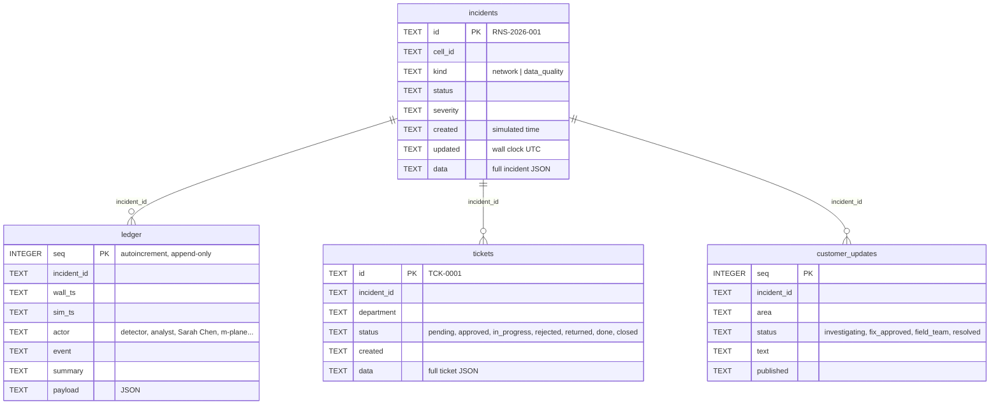

# API and database

All routes are defined in `backend/app/main.py`. All bodies are JSON unless noted. Authentication uses session cookies (see [Security](SECURITY_AND_ACCESS_CONTROL.md)):

- **ops** = the `ops_user` dependency, which needs the `rs_ops` cookie;
- **customer** = the `customer_user` dependency, which needs the `rs_connect` cookie.

A missing or unknown session returns `401`. FastAPI request models (pydantic) reject malformed bodies with `422`.

Error bodies use FastAPI's `{"detail": ...}`. The front ends read `detail.message` or a string `detail` (`UI.api`).

## 1. Static files and demo entry

| Method and route | Auth | Purpose | Request | Response and errors |
| --- | --- | --- | --- | --- |
| `GET /` | none | redirect | — | 307 to `/ops/` |
| `GET /ops/*`, `/connect/*`, `/shared/*` | none | static front ends, maps, vendor libraries | — | files |
| `POST /api/demo/start` | none | open sample-data demo | `{portal: "ops" or "connect"}` | `{ok, demo, name}` and a role-scoped HttpOnly, SameSite=Lax cookie; replaces this portal's previous session |
| `POST /api/login` | none | sign in to one portal | `{email, password, portal: "ops" or "connect"}` | `{ok, name}` and sets an `rs_<portal>` cookie (HttpOnly, SameSite=Lax). `401 "Email or password is incorrect."`. `403 {portal, message}` when the account belongs to the other portal |
| `POST /api/logout` | none | end both sessions | `{}` | `{ok}`; deletes both cookies |

Demo entry needs no credentials. The optional legacy private login is disabled for empty passwords; if configured, credentials are compared with `secrets.compare_digest` against `OPS_EMAIL` / `OPS_PASSWORD` or `CUSTOMER_EMAIL` / `CUSTOMER_PASSWORD`.

## 2. Operations API (all ops)

| Method and route | Purpose | Request | Response (main fields) | Errors |
| --- | --- | --- | --- | --- |
| `GET /api/state` | everything the overview, status bar and badges need, polled every 2–15 s | — | see the field list below this table | 401 |
| `GET /api/cells/{cell_id}` | cell explorer | — | cell info, `history` (48 windows), active `alarms`, M-Plane `config`, `detection`, KPI `units` | 404 unknown cell |
| `GET /api/incidents/{iid}` | incident detail | — | the full incident (evidence, trace, stages, diagnosis, plans, review, FCC, photos, brief…), `kpi_window` (32 windows), `alarms`, `config`, `ledger`, `ticket`, `regulatory_ticket_data` | 404 |
| `POST /api/incidents/{iid}/report` | Incident Reporter | — | `{text, by, generated_at}` | 404 |
| `POST /api/incidents/{iid}/photo?note=` | field photo: SAM 3.1 + vision | raw image body, `Content-Type` image/jpeg, png or webp, ≤ 6 MB | photo record: `id, detections[], findings, errors[], evidence_id…` | 404; 400 wrong type or size |
| `POST /api/incidents/{iid}/evidence` | a field engineer answers the open evidence request; the investigation resumes | `{note}` | the answered request | 404; 400 not waiting for evidence, empty note |
| `POST /api/incidents/{iid}/rca` | sign off or dispute the verified root cause | `{decision: confirm or dispute, note}` | the sign-off record | 404; 400 not verified, dispute without a note, incident past review |
| `POST /api/incidents/{iid}/resume` | resume an investigation the model API interrupted, from its checkpoint | — | `{resumed_at}` | 404; 400 nothing to resume |
| `GET /api/photos/{pid}` | photo bytes | — | the image | 404 |
| `POST /api/handover` / `GET /api/handover` | write / read the Muse Wonder shift handover | — | `{text, by, generated_at, incidents, input_chars}` | — |
| `POST /api/voice` | dictate a decision note | raw WAV body | `{text, turns, duration_ms, model, latency_s, intent}` | 400 not WAV; 413 > 30 MB; 503 voice unavailable |
| `GET /api/model-card` | detector design + benchmark results | — | `{detector{version, design}, benchmarks{simulator, telecomts}}` from `data/benchmarks/*.json` | — |
| `GET /api/alarms` | alarm monitor (last 400, newest first) | — | each alarm plus `site, zip_code, band, event_type, probable_cause, incident, ack` | — |
| `POST /api/alarms/{aid}/ack` | toggle acknowledgement | — | `{alarm_id, ack}` | 404 |
| `GET /api/tickets` | approvals queue | — | the list of tickets | — |
| `POST /api/tickets/{tid}/decide` | a department decision | `{decision: approve, reject, more_info, resolved, filed or close; note; user}` | the updated ticket | 404; 400 (already decided, reject without a reason, approving an escalation, `resolved` on a non-field ticket, `filed` on a non-regulatory ticket, unknown decision) |
| `GET /api/ledger` | the Safety Ledger (last 150) | — | ledger rows | — |
| `GET /api/catalogue` | fault types, actions, checks, KPI names | — | lists | — |
| `POST /api/demo/inject` | create a fault | `{cell_id, fault_type, severity: 1–3}` | the fault record | 400 unknown fault type |
| `POST /api/demo/flags` | demo switches | `{red_team?, api_outage?: none, primary_down or all_down, twin_outage?, diag_outage?, paused?}` | the flags | — |
| `POST /api/demo/step` | advance one tick | — | `{tick}` | — |
| `POST /api/demo/clear` | clear all faults | — | `{ok}` | — |
| `POST /api/demo/reset` | new `Sentinel` (fresh shift, store reset) | — | `{ok}` | — |

`GET /api/state` returns:
- `alarm_counts`, `unacked_alarms`;
- `model_stats{calls, failed, avg_latency_s}`;
- `sim_time`, `tick`, `paused`, `market`, `engine`, `offline`, `models{…}`, `twin`, `flags`;
- `summary{cells, watch, open_incidents, critical, pending_tickets, network_status}`;
- `cells[]`, each with `cell_id, site, sector, x, y, azimuth, zip_code, band, status, score`, KPIs, `fault`, `lat, lon, site_lat, site_lon, coverage_km, tx_power_dbm, tilt_deg`;
- `health[]` (the last 48 cluster-average windows), `incidents[≤30]` summaries, `activity`, `agent_calls[≤12]`.

Decision effects are in `Sentinel.decide` (`orchestrator.py`):
- `approve` on a config change applies it over M-Plane;
- `approve` on a field ticket moves the incident to FIELD_WORK;
- `resolved` clears the simulated fault and starts monitoring;
- `more_info` re-runs the investigation with the note;
- a root-cause dispute (`/rca`) returns the pending ticket and re-runs the investigation with the note;
- `reject` needs a note and sets REJECTED;
- `close` sets CLOSED;
- `filed` marks the regulatory ticket done.

## 3. Customer API (all customer)

Every care route goes through `_care()`. It creates `sentinel.care = Care(sentinel)` on first use and runs `Care.sync()` (notifications) under the lock.

| Method and route | Purpose | Request | Response (main fields) | Validation and errors |
| --- | --- | --- | --- | --- |
| `GET /api/public/status` | area statuses + published updates | — | `{region, timezone, areas[], updates[≤20]}` | — |
| `POST /api/public/assistant` | status assistant | `{question}` | `{answer, by}` | 400 empty question |
| `POST /api/public/voice` | spoken question | raw WAV | `{text, model}` | as `/api/voice` |
| `GET /api/care/home` | home page | — | `account, places[], notifications[≤5], unread, credits, prefs, now, timezone, engine` | — |
| `GET /api/care/network` | network page | — | `places[], areas[], reports[≤10], now, symptoms` | — |
| `GET /api/care/notifications` / `POST …/read` | notification list / mark all read | — | `{items}` / `{ok}` | — |
| `GET /api/care/account` | account page | — | `account, prefs, settings, places, areas, credits, applied, credit_policy` | — |
| `POST /api/care/prefs` | toggle a setting | `{key, value: bool}` | prefs | 400 unknown key |
| `POST /api/care/places` | change a saved place's ZIP | `{place, zip}` | places | 400 unknown place or ZIP |
| `POST /api/care/credit` | apply an eligible outage credit | `{reference}` | credit | 400 not eligible |
| `POST /api/care/report` | report a problem | `{place, symptom, details}` | `{id, outcome: linked or device_check, …}`; a linked report is added to the incident as `customer_report` evidence | 400 |
| `POST /api/care/concierge` | Care Concierge | `{question, history[]}` | `{answer, by, steps[], actions[]}` | 400 empty question |
| `POST /api/care/confirm` | run a proposed action | `{action_id}` | the result | 400 expired or unknown |
| `GET /api/care/map?place=` | towers near one saved place | — | `towers[]` (`key, name, lat, lon, technology, bands, distance_km, coverage_km, status, serving, alternative`), `bounds`, `place`, `source` | 400 if `place` is not the customer's own |
| `GET /api/care/signal?place=` | signal card | — | `metrics{rsrp_dbm, rsrq_db, sinr_db, latency_ms, packet_loss_pct}` each with value, unit, rating and name; `series[12]`, `quality`, `drivers`, `serving`, `alternatives`, `tower_changes`, `issue`, `guidance`, `thresholds`, `source` | 400 |
| `POST /api/care/signal/explain` | Signal Analyst | `{place}` | `{summary, confirmed, probable, unverified, steps, by, facts}` | 400 |
| `POST /api/care/phone` | move the simulated test phone | `{place, lat, lon}` | the new position | 400 if more than 1.5 km from the place |

Customer map and signal routes never return cell ids, transmit power, tilt or KPIs (tested in `tests/test_map_signal.py`).

## 4. Database

SQLite file `data/sentinel.db` (`Settings.db_path`), schema in `backend/app/store.py`. Created on first run (`CREATE TABLE IF NOT EXISTS`). There are no migrations. **The incident tables are emptied when a `Sentinel` is constructed** (`Store.reset()`), at every server start and at demo reset. The two support tables (`support_tickets`, `support_messages`) are kept, so help requests survive a restart and a demo reset.



- **Relationships:** these are by convention. There are no declared foreign keys and no indexes beyond the primary keys.
- **Ownership:** only the orchestrator writes incidents and tickets. The ledger is append-only: there is no update or delete method apart from `reset`.
- **Customer updates:** written only by `Sentinel._customer`, after the `FORBIDDEN` filter.
- **Ticket kinds** (in `data`): `config_change`, `field_action`, `escalation`, `regulatory`, `data_quality`.

Kept **in memory only**, and lost on restart:
- sessions;
- simulator state and history;
- detector state;
- alarm acknowledgements;
- photos (bytes);
- the shift handover;
- the whole customer-care state: notifications, places, preferences, credits, reports, pending actions, phone positions and explanations.

There is one fictional subscriber (`care.SUBSCRIBER`), not a customer table.

## 5. Help and support

Code: `backend/app/support.py` (validation, ticket rules, the 17 help articles) and the routes at the end of `backend/app/main.py`. Customer routes need the `rs_connect` session and only ever return that customer's own requests; staff routes need `rs_ops`. Any other caller gets 401. Validation errors return 422 with `{"detail": {"message", "fields": {field: message}}}`.

| Method and route | Who | Purpose | Errors |
| --- | --- | --- | --- |
| `GET /api/care/help?q=&category=` | customer | search articles and FAQs; empty `q` lists all | 400 unknown category |
| `GET /api/care/help/{id}` | customer | one article with steps, screenshot, links and related articles | 404 |
| `GET /api/care/support` | customer | my requests, newest first, with status labels and an unread flag | — |
| `POST /api/care/support` | customer | new request `{name, email, category, subject, description}`; returns the ticket with its `CS-` ID | 422 fields, 429 after 20 open requests |
| `GET /api/care/support/{id}` | customer | one request and its conversation; marks staff replies read | 404 if missing or not yours |
| `POST /api/care/support/{id}/reply` | customer | `{body}`; a waiting or resolved request goes back to open | 409 closed, 422 empty |
| `POST /api/care/support/{id}/close` | customer | close the request | 409 already closed |
| `GET /api/support/tickets?status=&category=&q=` | staff | all requests with counts per status; `status` is `active` (default), `all` or one status; `q` searches ID, subject, name, email and messages | 400 unknown filter |
| `GET /api/support/tickets/{id}` | staff | one request, its conversation and the customer's other requests | 404 |
| `POST /api/support/tickets/{id}/reply` | staff | `{body, status}`; status after reply defaults to `waiting_customer` | 409 closed (reopen with update first), 422 empty or unknown status |
| `POST /api/support/tickets/{id}/update` | staff | `{status?, priority?}`; each change is logged in the conversation | 400 nothing changed, 422 unknown status or priority |

Statuses: `open`, `in_progress`, `waiting_customer`, `resolved`, `closed`. Priorities: `low`, `normal` (default), `high`, `urgent`. Field limits: name 2 to 80 characters, email 5 to 254, subject 4 to 120, description 10 to 4000, reply 1 to 4000. Control characters are removed before saving.

```
support_tickets(seq INTEGER PRIMARY KEY, id TEXT UNIQUE "CS-100001", owner TEXT, status TEXT,
                category TEXT, priority TEXT, created TEXT, updated TEXT, data TEXT "full ticket JSON")
support_messages(seq INTEGER PRIMARY KEY AUTOINCREMENT, ticket_id TEXT, role TEXT "customer | staff | system",
                 author TEXT, body TEXT, created TEXT)
```

Indexes on `support_tickets(owner)` and `support_messages(ticket_id)`. Tests: `tests/test_support.py` (42) and `scripts/check_support_ui.js` (53 browser checks).
