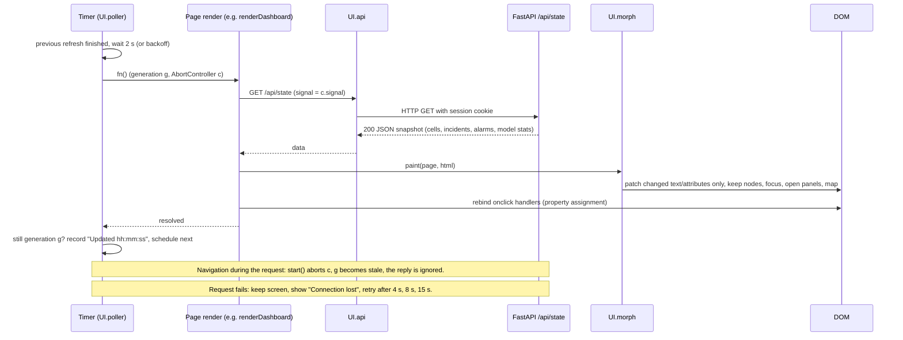

# Live-update architecture

How the two browser apps keep network data current, why the old refresh made the screen blink and lost clicks, and how the current code fixes that.

Files: `frontend/shared/ui.js` (`UI.morph`, `UI.poller`, `UI.api`), `frontend/ops/app.js` (`route`, `live`, `paint`, `showFeed`), `frontend/connect/app.js` (`route`, `view`, `poll`), `frontend/shared/geomap.js` (`GeoMap.mount`).

## 1. How data reaches the screen

The backend has no push channel: no WebSocket, no Server-Sent Events. Both apps poll REST endpoints over HTTP.

| App | Page | Endpoint(s) polled | Interval |
| --- | --- | --- | --- |
| Ops console | Network overview | `GET /api/state` | 2 s |
| Ops console | Alarm monitor | `GET /api/state`, `GET /api/alarms` | 3 s |
| Ops console | Cell explorer | `GET /api/state`, `GET /api/cells/{id}` | 4 s |
| Ops console | Incidents | `GET /api/state` | 2 s |
| Ops console | Incident detail | `GET /api/state`, `GET /api/incidents/{id}` | 2 s |
| Ops console | Approvals | `GET /api/state`, `GET /api/tickets` | 2 s |
| Ops console | Safety ledger | `GET /api/state`, `GET /api/ledger`, `GET /api/handover` | 4 s |
| Ops console | Model card | `GET /api/state`, `GET /api/model-card` | 15 s |
| Customer app | Home, Network, Notifications, Bill | that page's `/api/care/*` GETs | 5 s |
| Customer app | Account, Help, Report, Shop | `GET /api/care/home` (new-notification toast and badge only) | 8 s |

The backend advances the simulated network on its own thread: `backend/app/main.py:_loop` calls `Sentinel.tick()` every `SIM_TICK_SECONDS` (default 3 s). One tick is one 15-minute measurement window. Polling every 2 s therefore picks up every tick within about 2 s.

Polling was kept on purpose. The data model is a full snapshot per page, the server is a single local process, and a 2 s interval is well inside what the backend handles: `/api/state` reads in-memory state under one lock. Switching to SSE or WebSockets would add a new server mechanism without fixing the actual problem, which was in rendering (section 2).

## 2. Root cause of the flicker and the lost clicks (verified)

Before this change, every refresh did this (ops `paint()`; the customer app had the same pattern):

```js
app.innerHTML = shell(active, inner);   // the whole application, every 2 s
```

It was driven by `setInterval(run, every)`, where `run()` was an async render with no guard against overlap. The investigation found five concrete problems.

1. **The whole DOM was destroyed and rebuilt on every refresh.** A MutationObserver on the dashboard counted 1,974 element removals in 6 s, about 660 per refresh. Every button, row, link and input was a new element after each refresh.
2. **Lost clicks.** A browser fires `click` only when `mousedown` and `mouseup` land on the same element. If a refresh happened between the two, the element under the pointer had been replaced, so no click fired. Holding the mouse button across a refresh on a work-queue row opened the incident 1 time in 4.
3. **The blink.** The work area `<main class="work fade">` has a CSS fade-in animation. Because the element was new on every refresh, the animation replayed every 2 s; 3 to 4 replays were counted in 6 s. The same rebuild closed every open `<details>` (evidence items on the incident page) and dropped hover and focus state.
4. **Overlapping requests.** `setInterval` does not wait for the previous refresh. With a slow backend (2.5 s per `/api/state`), 2 requests were in flight at once and 5 were sent in 10 s.
5. **No failure state.** If the backend became unreachable, the last screen stayed up with no sign that it was stale. Errors only went to the browser console.

The old code also skipped refreshes while a text field or select had focus. That avoided losing typed text, but the page stopped updating while the cursor sat in the search box.

These numbers come from `scripts/check_live_refresh.js` and the measurement scripts used during the fix, run against the original files (section 7).

## 3. The fix

The interval and endpoints are unchanged. Two things changed: how a refresh is applied to the page, and how refreshes are scheduled.

### 3.1 In-place DOM patching: `UI.morph(target, html)`

Each page still builds its full HTML string from fresh data, so the render functions did not change. Instead of assigning it to `innerHTML`, `paint()` (ops) and `view.html` (customer) call `UI.morph(app, html)`. `morph` parses the new HTML into a detached element and walks both trees together.

- **Matching:** children are matched by `id` first, then by position when the tag and id agree. A matched element is kept and only its changed attributes and text are updated. Only an element with no match is created, and only one that is no longer present is removed.
- **User state is preserved:**
  - The focused `<input>` or `<textarea>` keeps its value and caret.
  - `<details open>` and `<dialog open>` keep the state the user set.
  - A `<select>` follows the markup only when it is not focused.
  - File inputs are never touched.
- **Persistent widgets:** an element marked `data-keep` keeps its children. The Leaflet map containers `#geoslot` (ops) and `#cgeoslot` (customer) use this, so the map object, its tiles and the zoom level are never rebuilt. `GeoMap.mount` moves the one map element into its slot and removes any empty-state message left there.
- **Event handlers:** pages bind handlers with `element.onclick = …` after each paint. Assigning a property replaces the previous handler, so reused elements never collect duplicate handlers.

Result: across 3 dashboard refreshes, 0 elements are replaced and the fade animation plays 0 times. The `<main>` element and the map element stay the same objects.

### 3.2 One refresh at a time: `UI.poller()`

Each app creates one poller: `poll` in ops `live()`, and `poll` in the customer `route()`.

```
poll.start(fn, everyMs, onFatal)   // on navigation: new page, cancel the old one
poll.now()                         // after a user action: refresh at once
poll.stop()                        // on the sign-in page
```

- **Serial:** the next refresh is scheduled with `setTimeout` only after the current one finishes, so there is never more than one request chain per page. A `poll.now()` that arrives during a refresh is queued once and runs right after it.
- **Navigation cancels the old page:** `start()` increments a generation counter and aborts the old `AbortController`. `UI.api` attaches the active refresh's abort signal to every GET it makes, and POSTs are never aborted. A slow reply for the previous page is cancelled, and any result whose generation is stale is ignored, so an old page can never paint over a new one.
- **Ordering:** because refreshes are serial within a page, and stale generations are dropped across pages, an older response cannot overwrite newer data.
- **Failures:**
  - The last good screen stays up.
  - The next attempt backs off: 2×, 4×, 8× the interval, capped at 15 s.
  - When the browser fires `online`, the poller retries immediately.
  - A 401 is not retried; it sends the user to the sign-in page.
- **Hidden tabs:** while `document.hidden` is true, no requests are made. On `visibilitychange` back to visible, the poller refreshes at once.
- **Pointer held down:** while a mouse button or finger is down (`pointerdown` to `pointerup`), a due refresh waits in 250 ms steps. This is a second safeguard for drags and long presses; the patching in 3.1 already keeps the touched element alive.
- **Busy work (ops):** `paused: () => busy` holds refreshes during a photo upload, voice recording or handover write, as before.

### 3.3 Data freshness is shown, not hidden

- **Ops status bar** (`#feed`, `aria-live="polite"`): normally shows "Updated hh:mm:ss". On failure it shows "Connection lost · showing data from hh:mm:ss · retrying in N s" in red, and the work area gets a red top edge (`.work.stale` in `ops.css`).
- **Customer app:** a toast says "Connection lost / Showing the last update. Retrying…" on the first failure, and "Back online" on recovery.

No data is delayed or held back. Each successful refresh is shown as soon as it arrives, including new alarms and incidents.

### 3.4 Smaller fixes in the same change

- **Customer Explain button:** "Reading…" is kept in `ui.reading`, so a refresh during the request no longer re-enables the button. A double tap sends 1 request.
- **Re-renders after actions:** these used to call the page function directly, which raced with the timer. They now call `poll.now()`. In the customer app this covers suggestions, the Wi-Fi Calling toggle, the credit and phone moves. In ops it covers `refresh()`.

## 4. Normal refresh cycle



## 5. What a user can do during a refresh (tested)

| Interaction | Result after fix | How it was checked |
| --- | --- | --- |
| Click a work-queue row while a refresh lands mid-click | Opens the incident 4 of 4 times (was 1 of 4) | `check_live_refresh.js` |
| Tap a tab in the customer app across a refresh | Switches 4 of 4 times | `check_live_refresh.js` |
| Type in the global search box across 2 refreshes | Text kept | `check_live_refresh.js` |
| Open an evidence `<details>` and wait 5 s | Stays open (was closed by the next refresh) | measurement script |
| Pick a cell and fault in Demo controls, wait 5 s | Both choices kept | measurement script |
| Scroll the customer Network page, wait 11 s | Scroll position kept (900 px) | `check_live_refresh.js` |
| Pan or zoom a map, drag the customer test phone | Map element never rebuilt; drag registers | `check_live_refresh.js`, earlier map checks |
| Slow backend (2.5 s per `/api/state`) | At most 1 request at a time, 2 in 10 s (was 2 at once, 5 in 10 s) | `check_live_refresh.js` |
| Fast navigation while requests are slow | The last page clicked wins | measurement script |
| Backend unreachable for 5 s | Last data stays up and the failure is shown; recovers within 15 s | `check_live_refresh.js` |
| Live data | Simulated clock and KPIs keep advancing | `check_live_refresh.js` |

## 6. Known limitations

- **Full snapshots:** each refresh still downloads the page's full snapshot; there is no incremental diff from the server. `/api/state` is about 36 cells plus 48 history points and up to 30 incidents, so this is small. A much larger network would need paging or an incremental endpoint.
- **Client-side HTML:** each refresh still builds the page's HTML string in the browser. The cost is a few milliseconds at this size. Patching removes the DOM churn, not the string building.
- **Matching by position:** reordered list rows without ids are patched in place rather than moved. That is correct visually, but a row the pointer is on can show different content after a re-sort. Tables here are sorted by stable keys (incident id, time), so this has not been observed.
- **Hidden-tab pause:** this behaviour was checked by code review, not by an automated test.
- **Large datasets:** high-volume updates and much larger datasets were not load-tested.
- **Alarm delivery:** there is no push. A critical alarm appears on the next poll, within about 2 s plus the simulator tick.

## 7. How to re-run the checks

One-time setup in the project folder: `npm i --no-save playwright`, then `npx playwright install chromium`. With the app running (`py run.py`), run `node scripts\check_live_refresh.js` from the project folder. It reads the sign-in settings from `.env` and creates one demo fault if there is no open incident ([Setup](SETUP_AND_DEPLOYMENT.md#7-tests)).

It prints PASS or FAIL for 12 checks and exits non-zero on any failure.
