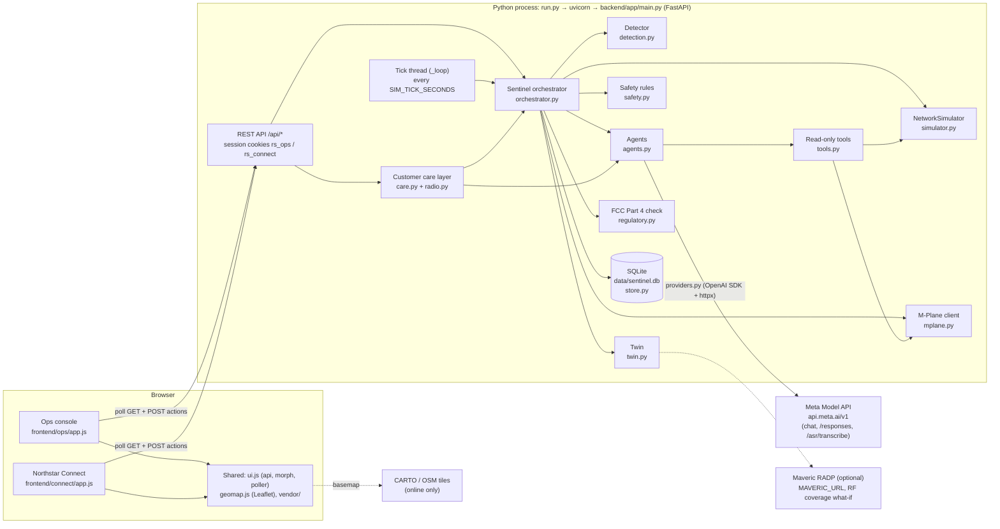
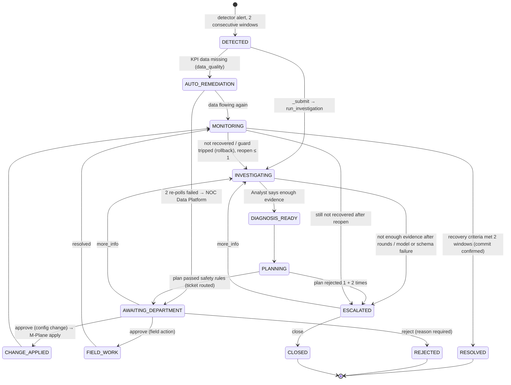
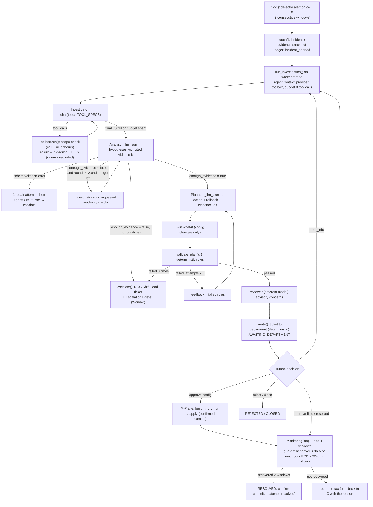

# System architecture

RAN Sentinel is a single-process prototype of an AI co-engineer for a mobile radio access network (RAN).

- **Simulated network:** a 36-cell LTE network in Seattle, WA, run by the fictional carrier Northstar Connect.
- **Detection:** a detector finds degrading cells.
- **Agents:** Meta Muse Spark agents investigate with read-only tools and propose a fix.
- **Safety:** fixed safety rules and a digital twin check the fix.
- **Approval:** a department approves it.
- **Change:** an approved change is sent as an O-RAN M-Plane style change package with automatic rollback.
- **Customers:** a separate customer app shows customers only confirmed, plain-language information.

Everything that would touch a real operator is simulated: the network, the radio units, the KPIs and the customer account. This document describes the code as it is in this repository.

Related documents:
- [AI agents and models](AI_AGENTS_AND_MODELS.md)
- [Live updates](LIVE_UPDATE_ARCHITECTURE.md)
- [API and database](API_AND_DATABASE.md)
- [Setup and deployment](SETUP_AND_DEPLOYMENT.md)
- [Security](SECURITY_AND_ACCESS_CONTROL.md)
- [Implementation and test report](IMPLEMENTATION_AND_TEST_REPORT.md)

## 1. Purpose and users

| Who | App | What they do |
| --- | --- | --- |
| NOC engineer (the demo user is "Sarah Chen") | Operations console `/ops/` | Watches the cluster, alarms and cells. Reads AI investigations and approves, rejects or sends back recommendations as a department. Adds field photos and voice notes, and runs demo controls. |
| Customer (fictional subscriber "Jordan Rivera") | Northstar Connect `/connect/` | Sees service status, recovery estimates and notifications for their own saved places (Home, Work, Gym). Sees their signal and the towers near them, reports problems, and asks the Care Concierge. |

The problems it addresses:
- **Slow diagnosis:** a degrading cell is spotted late and diagnosed by hand.
- **Risky changes:** configuration changes go out without a predicted impact or a rollback.
- **Customers in the dark:** customers learn about problems late and get little detail.

There are two roles, ops and customer. Each is a separate sign-in with its own session cookie. Department roles (RAN Optimisation, Field Operations and so on) are ticket owners, not separate logins: the one ops user acts for every department. See [Security](SECURITY_AND_ACCESS_CONTROL.md).

## 2. Components

| Module | File | Responsibility |
| --- | --- | --- |
| Web app | `backend/app/main.py` | FastAPI app, static file mounts (`/ops`, `/connect`, `/shared`), login, every REST route, background tick thread |
| Settings | `backend/app/config.py` | Reads `.env` (via python-dotenv) into a `Settings` dataclass; orchestrator budgets |
| Simulator | `backend/app/simulator.py` | 12 sites × 3 sectors = 36 LTE cells (B66, B2, B71), KPIs every 15 simulated minutes, alarms, 5 injectable fault types, 7 days of normal training data |
| Detection | `backend/app/detection.py` | Data-quality checks, 7 threshold rules, Isolation Forest (200 trees), per-cell per-hour baseline (Mahalanobis distance); 2 consecutive windows to alert |
| Orchestrator | `backend/app/orchestrator.py` | `Sentinel`: incident state machine, budgets, evidence loop, plan-retry loop, recovery monitoring, escalation, ticket routing, photos, handover |
| Agents | `backend/app/agents.py` | Investigator, Analyst, Planner, Reviewer, Reporter, Escalation Briefer, Shift Handover, Field Photo Analyst, Customer Comms, status assistant; each with an offline rules or template fallback |
| Model provider | `backend/app/providers.py` | `MetaProvider` (Meta Model API: chat completions, SAM 3.1, Voice Transcribe) with retry and fallback chain; `OfflineProvider` when no key |
| Tools | `backend/app/tools.py` | 5 read-only tools for the Investigator, scoped to the incident cell and its neighbours |
| Safety | `backend/app/safety.py` | Action allow-list, step and bound limits, cause-to-action fit, evidence citation, rollback, sandbox impact; department routing |
| Twin | `backend/app/twin.py` | What-if sandbox. `MavericTwin` (Maveric RF twin for coverage, `maveric.py`) when `MAVERIC_URL` is set, else `FallbackTwin` (simulator copy) |
| M-Plane | `backend/app/mplane.py` | NETCONF-style get-config / edit-config / validate / confirmed-commit / rollback against in-process simulated radio units |
| Regulatory | `backend/app/regulatory.py` | FCC Part 4 (47 CFR 4.9(e)) outage reportability estimate. Decision support, not legal advice |
| Store | `backend/app/store.py` | SQLite: incidents, append-only ledger, tickets, customer updates |
| Customer care | `backend/app/care.py` | Customer view of incidents, notifications, recovery estimate, suggestions, credits, reports, Care Concierge, tower map, signal card, Signal Analyst |
| Radio model | `backend/app/radio.py` | Site lat/lon, path loss, antenna pattern, coverage radius, simulated phone measurement, per-metric quality bands |
| Ops UI | `frontend/ops/` | Single-page app (vanilla JS): network overview, alarm monitor, cell explorer, incidents, approvals, safety ledger, model card, demo drawer |
| Customer UI | `frontend/connect/` | Mobile-first single-page app: Home, Network, Account, Bill, Help (Concierge), Notifications, Report, Shop |
| Shared UI | `frontend/shared/` | `ui.js` (API helper, DOM patching, poller, charts), `geomap.js` (Leaflet map), `base.css`, `vendor/` (Leaflet 1.9.4, topojson-client 3.1.0, us-atlas states) |

## 3. Runtime model

- **One process:** `run.py` starts uvicorn on `127.0.0.1:8000` with `app.main:app`.
- **Startup:** at startup, `lifespan` builds one `Sentinel`. That trains the detector on 7 simulated days, then the code starts a daemon thread, `_loop`.
- **Tick thread:** every `SIM_TICK_SECONDS` (default 3 s), `_loop` calls `sentinel.tick()`. A tick:
  1. advances the simulator one 15-minute window;
  2. runs the M-Plane confirm-timeout backstop;
  3. evaluates the detector on every cell;
  4. opens or attaches incidents;
  5. runs the FCC check, data-quality remediation and recovery monitoring.
- **Investigations:** these run on a `ThreadPoolExecutor(max_workers=2)` (`Sentinel.executor`), so model calls never block the tick. Tests set `sentinel.sync = True` to run them inline.
- **Shared state:** state lives in memory on the `Sentinel` object: `incidents`, `open_by_cell`, `latest` detection results, simulator history and `photos`. It is guarded by one `threading.RLock` (`sentinel.lock`). Incidents, the ledger, tickets and customer updates are also written to SQLite. Customer-care state (notifications, places, preferences, credits) lives only in memory, on `sentinel.care`.
- **Restarts:** the database is reset each time a `Sentinel` is created (`Store.reset()`). A restart, or the demo reset, starts a fresh shift.

## 4. Incident workflow

`CHANGE_APPLIED` is part of the state set (`OPEN_STATES`). In the current code, `_apply_change` moves straight on to `MONITORING`.

Who decides each transition: only orchestrator code changes `inc["status"]`. Agents return data, and humans decide through `POST /api/tickets/{id}/decide`. The model cannot approve, apply or close anything.

Customer-facing updates are published by `Sentinel._customer` at fixed points:
- `investigating`, when a major or critical incident opens;
- `field_team`, when a hardware fault is routed to Field Operations;
- `fix_approved`, when a change is applied;
- `resolved`, on recovery.

The customer app shows only these published updates.

## 5. The agentic execution loop

The model is used in two different patterns.

1. **Genuine iterative tool loops** (the model decides the next step):
   - The Investigator (`agents.investigate`) calls read-only tools until it answers or hits its budget.
   - The Care Concierge (`Care.concierge`) calls customer-scoped tools for up to 6 steps.
2. **Fixed pipeline steps with validation** (code decides the order, and the model fills one structured step):
   - Analyst, Planner, Reviewer, Reporter, Escalation Briefer, Shift Handover, Field Photo Analyst, Customer Comms, Signal Analyst, status assistant.

Around the Investigator and Analyst, the orchestrator adds an outer evidence loop. Around the Planner, it adds a plan-revision loop. Those loops are code-controlled, with fixed limits.

Termination and limits are enforced in code (`config.py`, `agents.py`, `providers.py`):

| Guard | Value | Where |
| --- | --- | --- |
| Investigator tool calls per incident | 12 (`max_tool_calls`) | `AgentContext.tool_budget`, `_call_tool` |
| Investigator model turns | `tool_budget + 2` | `agents.investigate` loop bound |
| Evidence rounds | 2 extra (`max_evidence_rounds`) | `run_investigation` |
| Plan attempts | 1 + 2 retries (`max_plan_retries`) | `run_investigation` |
| Schema repair | 1 per JSON agent call (`_llm_json(max_repairs=1)`) | `agents._llm_json` |
| Model attempts per call | primary, primary again after 1 s, fallback, last resort | `MetaProvider.chat` |
| Reopen after a failed fix | 1 (`max_reopen`) | `Sentinel._reopen` |
| Recovery monitoring | 4 windows (`monitor_ticks`) | `Sentinel._monitor` |
| M-Plane confirm timeout | 6 ticks (90 simulated min) | `mplane.CONFIRM_TIMEOUT_TICKS` |
| Care Concierge tool steps | 6 | `Care.concierge` |
| Any unexpected exception | escalate, never leave an incident stuck | `run_investigation` `except Exception` |

Agent-by-agent detail is in [AI agents and models](AI_AGENTS_AND_MODELS.md).

## 6. Data flows

| Data | Source | Update | Transform | Stored | Consumed by | Kind |
| --- | --- | --- | --- | --- | --- | --- |
| Cell KPIs (10 per cell) | `NetworkSimulator.step()` | every tick | diurnal load model, faults | memory, 96-tick history | detector, tools, `/api/state`, `/api/cells/{id}`, radio model | **Simulated** |
| Alarms | simulator `_raise_alarm` | on fault | X.733-style event type and probable cause added in `main.py` | memory | alarm monitor, tools | **Simulated** |
| Detection results | `Detector.evaluate` | every tick | rules, Isolation Forest, baseline | `sentinel.latest` | cell status, incidents | Derived |
| Incidents | `Sentinel._open` | on alert, then by the workflow | state machine | memory + SQLite `incidents` | ops pages, care layer | Derived |
| Evidence | tool results, customer reports, photos | during investigation | source and timestamp attached | inside the incident | Analyst, Planner, engineer | Derived from simulated data |
| Diagnoses, plans, reviews, reports, briefs | Meta models (or rules offline) | per step | schema-checked | inside the incident, ledger | engineer | **Model interpretation** |
| Safety-rule results, routing | `safety.py` | per plan | deterministic | inside the incident and ticket | engineer, department | Authoritative (code) |
| Radio config | `MPlaneClient` | on read and apply | NETCONF-style XML | memory (`sim.cells[].config`) | tools, planner, change | **Simulated** radio units |
| Customer updates | `Sentinel._customer` | at fixed workflow points | text checked by `FORBIDDEN` | SQLite `customer_updates` | customer app, status assistant | Derived |
| Tower and sector positions | simulator km grid → `radio.to_latlon` | static | anchored at Downtown Seattle (47.6062, -122.3321) | computed | both maps | **Fictional sites** near real neighbourhoods |
| Coverage radius | `radio.coverage_km` | per window (a hardware fault shrinks it) | TR 36.942 path loss to -110 dBm | computed | both maps | **Modelled** |
| Customer signal (RSRP, RSRQ, SINR, latency, loss) | `radio.measure` at the simulated test phone | per window, last 12 kept | radio model + cell KPIs | computed on request | signal card, Signal Analyst, Concierge | **Simulated** test phone, labelled |
| Serving tower | strongest modelled RSRP | per window | never chosen by distance | computed | map, signal card | **Simulated** |
| Browser connection type | `navigator.connection` | on page load | none | none | signal card, marked "not cellular" | Real (browser), not cellular |
| Notifications, credits, places, preferences | `Care.sync` and customer actions | on each care request | rules | memory (`sentinel.care`) | customer app | Derived / demo data |
| Model call log | `MetaProvider._record` | every call | agent, model, ok, latency, usage, error (no prompts) | memory, last 500 | status bar, model stats, handover | Operational |
| Benchmarks | `scripts/benchmark_*.py` | when run | — | `data/benchmarks/*.json` | model card | Measured offline |

Nothing in the app reads real network measurements. `scripts/benchmark_telecomts.py` uses the public TelecomTS dataset to benchmark the detection method only; it is not part of the live app.

## 7. Technology stack

| Layer | Technology (version constraint) | Role | Why (from the code and docs) |
| --- | --- | --- | --- |
| Language | Python 3.10+ (`start.bat` message) | backend | — |
| Web framework | FastAPI ≥ 0.110, Uvicorn ≥ 0.29 | REST API, static files | typed request models (pydantic), threadpool for slow model calls |
| ML | NumPy ≥ 1.26, scikit-learn ≥ 1.4 | Isolation Forest, Ledoit-Wolf covariance for the baseline | no language model in detection |
| Model client | `openai` ≥ 1.30 SDK, `httpx` ≥ 0.27 | Meta's OpenAI-compatible chat endpoint; raw HTTP for SAM and voice | the Meta Model API is OpenAI-compatible |
| Config | `python-dotenv` ≥ 1.0 | loads `.env` | keeps the key out of code |
| Storage | SQLite (stdlib `sqlite3`) | incidents, ledger, tickets, customer updates | single file, no server |
| Tests | pytest ≥ 8.0; Playwright (optional, Node) for `scripts/check_live_refresh.js` | regression tests | — |
| Frontend | Vanilla JavaScript, no build step, no framework | two single-page apps with hash routing | served directly as static files |
| Maps | Leaflet 1.9.4 (BSD-2), topojson-client 3.1.0 (ISC), us-atlas 3.0.1 states-10m (US Census Bureau, ISC); CARTO light tiles over OpenStreetMap when online | interactive US and cluster maps | bundled in `frontend/shared/vendor`, so state outlines work offline |
| Fonts | IBM Plex (SIL OFL) | UI type | — |
| AI provider | Meta Model API (`META_BASE_URL`, default `https://api.meta.ai/v1`) | all model calls | see [AI agents and models](AI_AGENTS_AND_MODELS.md) |
| Twin (optional) | Maveric RADP (`MAVERIC_URL`) | external what-if engine | coverage before/after a tilt or power change; falls back to the simulator copy if unavailable |
| Background work | one `threading.Thread` (tick) + `ThreadPoolExecutor(2)` (investigations) | — | no external queue or scheduler |
| Deployment | local only: `run.py` / `start.bat` on 127.0.0.1:8000 | — | no container, cloud or CI configuration exists in the repository |

There is no message queue, no external scheduler, no WebSocket or SSE, no ORM and no migration tool.
