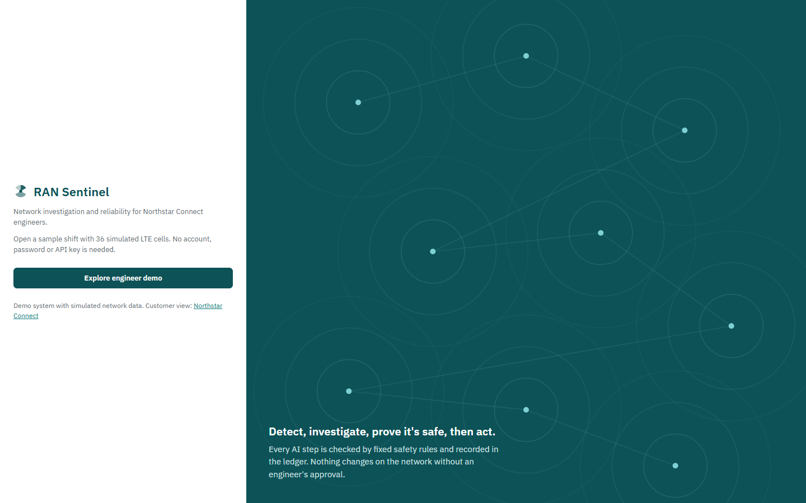
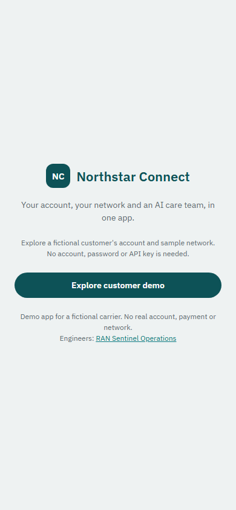
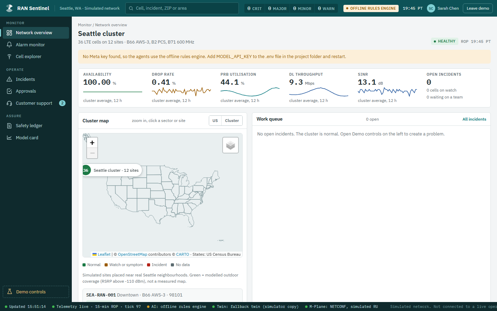
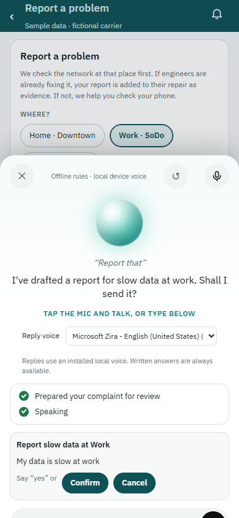

# RAN Sentinel: complete user manual

Edition: 4 November 2026. Author: AKMaasif (QuanTell). This guide covers the local no-login demo and local device speech revision. Network, account, payment and radio actions are simulated for the fictional carrier Northstar Connect.

## 1. Start here

Install Git and 64-bit Python, clone the public repository, and enter its folder. Python 3.14 matches the previously verified installation series.

```text
git clone https://github.com/AKMaasif/Meta-Ai-Global-Hackathon-Ran-Sentinel-.git
cd Meta-Ai-Global-Hackathon-Ran-Sentinel-
```

On Windows, double-click `start.bat` or run `./start.bat` from PowerShell. It prepares the environment and starts a local server. Keep the terminal open. Manual setup:

```text
py -3 -m venv .venv
.\.venv\Scripts\python.exe -m pip install -r requirements.txt
if (!(Test-Path .env)) { Copy-Item .env.example .env }
.\.venv\Scripts\python.exe run.py
```

On macOS or Linux:

```text
python3 -m venv .venv
.venv/bin/python -m pip install -r requirements.txt
[ -f .env ] || cp .env.example .env
.venv/bin/python run.py
```

Ubuntu/Debian may first need `sudo apt-get update` and `sudo apt-get install python3-venv`. If Python names a version-specific package, install that package instead. macOS does not use apt-get. If the Windows `py` launcher is missing, use `python -m venv .venv` for the first command.

| Portal | Open | Choose |
|---|---|---|
| Engineer console | http://127.0.0.1:8000/ops/ | Explore engineer demo |
| Customer app | http://127.0.0.1:8000/connect/ | Explore customer demo |

No account, password, access code, external signup or API key is needed to explore sample data. Both local roles are intentionally open. They share the fictional network and customer account; voice dialogue and pending voice approvals are separate per browser session. Do not enter private customer information or expose this prototype as a public account service.





## 2. Choose what to enable

The basic installation includes offline investigations, the simulated network, customer status, reports, Help and Support, and typed assistant conversations. Offline results are labelled as rules-based; they are not live Meta outputs. An installed local English system voice can read replies without a TTS account.

Live reasoning, speech transcription and image analysis require privately configured Meta API access. Set `MODEL_API_KEY` in the ignored `.env`, restart the server, and check that the console shows Meta Model API. Keep secrets out of browser code, documents and recordings. The three-minute submission video should demonstrate actual live Meta calls; a no-key walkthrough alone does not demonstrate live AI.

Speech output uses only installed local browser/OS voices. It makes no cloud TTS requests. Choose a local voice in Ask or select Text only. The available voices differ between computers; installing an English system voice may be necessary.

Docker is optional. It runs the separate Maveric RF coverage service, not the main Python app. Without it the app uses the labelled simulator twin. The step-by-step instructions are in `docs/MAVERIC_TWIN.md`; on Windows, preserve Linux line endings when cloning upstream Maveric. No Docker installation is required for the basic demo.

## 3. Explore the engineer console

The Network overview shows cluster KPIs, sites, cells, alarms and the work queue. Use the search box to find a cell, incident, ZIP or area. Open a map sector or Cell explorer to inspect KPI trends, configuration and alarms. Without street tiles, the bundled map outlines remain available.



Use Demo controls to inject a fault into a simulated cell. Detection requires telemetry windows; allow several ticks before expecting an incident. The supported scenarios include capacity surge, interference, overshoot, hardware failure and missing KPI data.

Open an incident to follow its investigation. Diagnosis explains evidence and root-cause hypotheses. Plans and safety shows proposed changes, fixed policy checks and twin predictions. Evidence lists the read-only tools. Agent console and the ledger show the investigation trace. Offline mode uses deterministic rules; live mode records actual model calls.

Approvals groups work by department. Review the diagnosis, evidence, safety verdict and expected impact before approving, rejecting or requesting more information. Approval permits only the validated simulated action. A change goes through the simulated M-Plane and monitored recovery, with rollback when recovery fails. Never describe this prototype as controlling real operator radios.

If an investigation asks for field evidence, answer the specific question and optionally attach a supported photo, CSV, PDF, DOCX or text file. The sample field-evidence folder contains useful examples. Photos and spoken notes need Meta access for their AI interpretation. Unsupported or malformed files are rejected rather than treated as valid evidence.

The Customer support desk is separate from network incident tickets. Filter requests, open a conversation, reply, change its status or set priority. The badge identifies unread customer messages. A staff reply appears in the customer app through its normal refresh cycle.

## 4. Explore the customer app

Home shows service status at the fictional subscriber's saved Home, Work and Gym places. Network shows connection tests, nearby towers and signal explanations. Internal cell identifiers and unconfirmed engineering diagnoses are filtered from this customer view.

Report an issue opens a form for place, symptom and details. Review the contents before pressing Send. Account contains sample preferences, Bill shows fictional charges, and Notifications contains published updates. These are demonstration records, not real payments or carrier settings.

Help includes topic filters, searchable FAQs and articles with steps and related links. Contact support accepts a name, reply email, category, subject and description. These are report details, not demo login credentials. The server validates fields as well as the browser.

After sending a support request, keep its reference and open My support requests to follow replies. A new staff reply produces a marker. Opening the thread marks it read. Replying to a resolved request reopens it; a closed request cannot accept further replies.

## 5. Talk or type to the assistant

Open Ask. Without Meta access, use its text box. With Meta access and microphone permission, tap the microphone, speak, then pause. The browser converts the recording to WAV; Meta transcribes it; the conversation layer chooses a deterministic tool or asks Muse Spark to reason with scoped tools.

Try this conversation:

1. "My data is slow at work." The assistant checks the current connection at Work.
2. "Report that." It uses the remembered symptom and place to prepare a draft.
3. "Actually, change it to home." The draft changes and gets a new approval ID.
4. "Read it back." It reads the revised draft.
5. "Cancel." The draft is retired without submission.



To test submission separately, prepare another draft and explicitly confirm in a later turn or use Confirm. The model cannot approve its own proposal. A correction invalidates the old ID, and repeated requests cannot submit the same confirmed action twice. Check the actual report reference rather than assuming speech playback means submission succeeded.

The assistant also opens pages and prepares preference changes, such as Wi-Fi Calling. Reading information and opening pages require no extra approval. Complaints, credits and settings wait for the relevant customer confirmation.

The Reply voice selector lists local English voices only. Text only disables spoken output. During speech, the microphone stays off to prevent echo. Tap the orb to interrupt; closing Ask cancels playback and stops late responses from navigating. If playback fails, read the complete written answer.

## 6. What the conversation remembers

The server holds recent dialogue, brief older customer context, the current issue, one pending proposal, recent action outcomes and a bounded retry cache. It uses new tools for current facts; an old answer is not proof that a network condition is still current.

Refreshing restores the current conversation and draft. Closing Ask keeps it. New conversation, leaving and reopening a demo session, server restart or simulator reset clears the relevant context. After 30 minutes without activity, the next access expires voice context and pending approvals. This is bounded session memory, not permanent recall.

## 7. Verify the installation

Run the isolated smoke check with your environment's Python:

```text
.\.venv\Scripts\python.exe scripts/check_local_install.py
.\.venv\Scripts\python.exe -m pytest tests -q
```

On macOS/Linux, replace the Windows Python path with `.venv/bin/python`. The smoke check starts a temporary no-key server and tests both demo roles, bundled assets, access restrictions and one investigated fault without resetting your running demo.

Current local Windows verification passed 206 application tests, 8 local-speech browser checks, 12 voice UI checks, 14 voice-memory checks, 53 support UI checks and 12 live-refresh checks. Browser speech tests use synthetic voices; they do not establish physical speaker quality. The full test run emitted three SQLite resource warnings. See `docs/LOCAL_INSTALL_VERIFICATION.md` for details and platform scope.

Earlier published Linux/macOS and native Safari results apply to the previous revision. The current revision remains local until the owner tests it and authorizes publication; hosted macOS checks have not been rerun for it.

## 8. A three-minute demonstration

Prepare the environment beforehand, enable Meta privately and keep keys off screen. Show the no-login engineer entry, one prepared simulated incident, the live Meta investigation trace, safety and twin checks, and the engineer's decision. Then show the customer experience: the published update or voice complaint draft and its confirmation/cancellation. End with the public repository and setup guide.

Be explicit about sample data and simulated radios. Show live Meta outputs in the video rather than claiming that rules-based responses are model calls. The existing videos document an earlier revision and should be refreshed before submission to match this workflow.

## 9. Troubleshooting

| Problem | What to do |
|---|---|
| Port 8000 is occupied | Stop the earlier server or run `run.py --port 8001` with the environment's Python; open the printed URLs. |
| Missing Python package | Install `requirements.txt` with the same environment's Python. |
| Ubuntu cannot create a venv | Install the venv package named by Python and repeat setup. |
| The app still shows the old entry page | Stop the earlier process, start this checkout and refresh the page. |
| No spoken reply | Choose a local English voice, check OS volume, or use Text only. Online-only voices are deliberately excluded. |
| Microphone cannot transcribe | Allow browser permission and check Meta access. Use typed input in no-key mode. |
| The map has no street tiles | Internet tiles are optional; bundled outlines remain available. |
| A proposal cannot be confirmed | Review the latest draft; the older ID may have expired or been replaced. Prepare it again if necessary. |
| Network state changed after restart | Simulator data resets at startup and demo reset. Support records have separate persistence. |

Use one running instance per checkout. Press Ctrl+C in its terminal to stop it. Open demo access is intended for local fictional data and is not production authentication.

For architecture and API details, read the technical PDF or `docs/SYSTEM_ARCHITECTURE.md`, `docs/VOICE_AGENT.md`, `docs/VOICE_CONVERSATION_MEMORY.md` and `docs/API_AND_DATABASE.md`.
