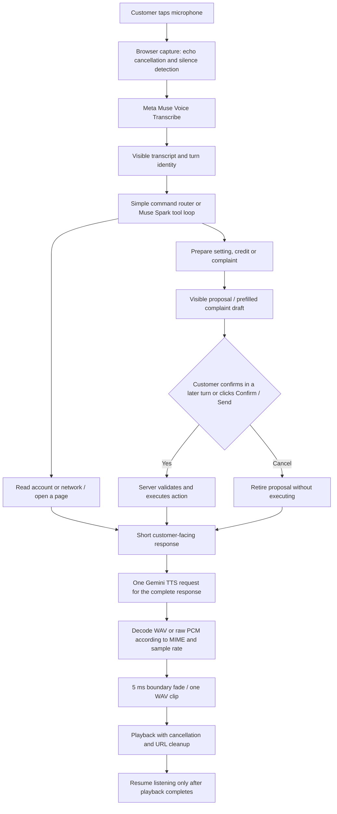

# Voice agent architecture and audio pipeline

## Research and architecture choice

A chained assistant separates microphone capture, speech recognition, conversation/tool execution, speech generation and playback. A native speech-to-speech assistant can reduce pipeline stages and support streaming conversation, but needs a compatible realtime audio model and careful tool/confirmation handling. This project retains its Meta transcription and Muse Spark integrations and uses a chained design with inspectable text and explicit customer confirmation.

Primary references reviewed on 3 November 2026:

- [Home Assistant: how voice works](https://contributors.home-assistant.io/architecture/platform/voice/): input audio, speech recognition, an agent that chooses actions, and synthesized replies; simple commands can run through local intent matching.
- [Google: speech generation](https://ai.google.dev/gemini-api/docs/speech-generation): Gemini 3.8 reads transcript text verbatim; styling belongs in separate speech metadata. Unary Gemini 3.8 defaults to WAV, whereas older preview integrations commonly expected raw PCM. Streaming and unary responses require different format handling.
- [Google: Gemini-TTS](https://docs.cloud.google.com/text-to-speech/docs/gemini-tts): delivery, voice and style are separate concerns from the application agent's tools and decisions.

Typed input joins at the conversation stage. Speech recognition does not itself authorize an action: the server checks explicit agreement and prevents a proposal from confirming itself in the same turn. Account changes are limited to the tools already exposed by this demo, not arbitrary browser or operating-system control.

## What was wrong

The browser split each response into separate sentence-level TTS requests and played several clips. The server assumed every response was raw 24 kHz PCM and wrapped it in a WAV header. A live provider check returned `audio/wav`: the old code would wrap an existing WAV file as raw audio. Container bytes can become audible noise. Repeating this per sentence multiplies boundaries. This is a verified format defect and a plausible source of the reported sound; perceived audio quality still needs a listening check.

Interruption also paused an audio element without settling its awaited promise. Closing or replacing a turn could leave unfinished work, and a late agent result could still update the screen or navigate.

## Local changes

- One TTS request and one clip per assistant reply, preserving continuous phrasing.
- Parse all audio parts, distinguish WAV containers from raw PCM, preserve the supplied rate, and reject unsupported formats, inconsistent rates and incomplete samples.
- Apply a 5 ms fade at either boundary without removing spoken content. This suppresses discontinuity clicks; it does not attempt to cut off model-generated syllables or breaths.
- Keep transcript text free of stage directions. Live round-trip testing caught those instructions being read aloud by Gemini 3.8.
- Abort speech generation on interruption; stop playback, release object URLs, settle playback promises, and ignore stale responses using turn identity.
- Do not start recording until the assistant finishes speaking; tapping the orb interrupts playback and starts another listening turn.
- Show report details and Confirm / Cancel controls; open a prefilled report draft or the relevant account/bill page.
- A later explicit spoken yes, bound to the proposal currently displayed by the client, or button confirmation executes an action. Questions and negated agreement do not authorize it. Manual submission of an edited report retires the voice proposal first, preventing a later yes from resubmitting the original draft.
- Keep API keys exclusively on the server. Configuration was checked by presence only, without printing credentials.

## Configuration and measured behavior

The local configuration uses Meta Muse Voice Transcribe, Muse Spark 1.3, Gemini 3.8 Flash-Lite TTS with Gemini 3.8 Flash TTS fallback, and Kore. No credential or model setting was changed.

A corrected two-sentence Kore sample took 3.22 seconds to generate and contained 4.4 seconds of speech. A live Meta transcription round trip recovered the intended complaint-confirmation wording, with a repeated word in the transcription. The project owner listened to this corrected sample and confirmed that the unwanted ending sound was gone. This sample-level confirmation does not establish perfect recognition or zero artifacts for every generated reply. The architecture is turn-based, not realtime streaming, and requires a tap to interrupt; there is no automatic barge-in while the microphone is off during playback.

## Verification

Use `python -m pytest tests -q` for the application suite. The explicit `tests` directory avoids collecting tests from a separate ignored Maveric checkout on this PC.

`node scripts/check_voice_ui.js` targets an **isolated offline demo** at `http://127.0.0.1:8021` by default, with demo engineer and customer credentials. It resets the isolated simulator before running. Override `BASE_URL`, `CUSTOMER_EMAIL`, `CUSTOMER_PASSWORD`, `OPS_EMAIL` and `OPS_PASSWORD` when needed. It creates and confirms demo reports/settings, so do not point it at an existing demo you want to preserve. It stubs speech HTTP responses and checks one clip per answer, confirmation/cancellation, draft contents, stale-response suppression and recovery after cancellation. It does not test real microphone hardware or subjective sound quality.

`python scripts/check_voice_agent.py` uses the configured providers, makes billable model/speech calls, and keeps its account changes in an in-memory demo. With `--audio path.wav`, it also tests Meta transcription.

Final local verification: **193 application tests passed in 520.78 seconds**, **12 voice UI checks passed**, and **53 support UI checks passed**. The live four-turn Meta/Gemini conversation passed, including preparing a complaint, waiting for spoken confirmation, submitting it and opening the bill. A generated Kore reply also passed a live Meta transcription round trip. The existing virtual environment was repaired by installing its missing `pypdf` dependency from the unchanged requirements file; `pip check` reported no broken requirements.

Browser verification passed all 12 voice UI checks. A focused Python run passed all 24 voice-agent checks, including WAV container decoding, raw PCM, multipart audio, sample rates, edge fades, complaint drafts, and confirmation safeguards.

See the [voice guide](VOICE_AGENT.md) for setup and the [conversation memory guide](VOICE_CONVERSATION_MEMORY.md) for the current workflow.
