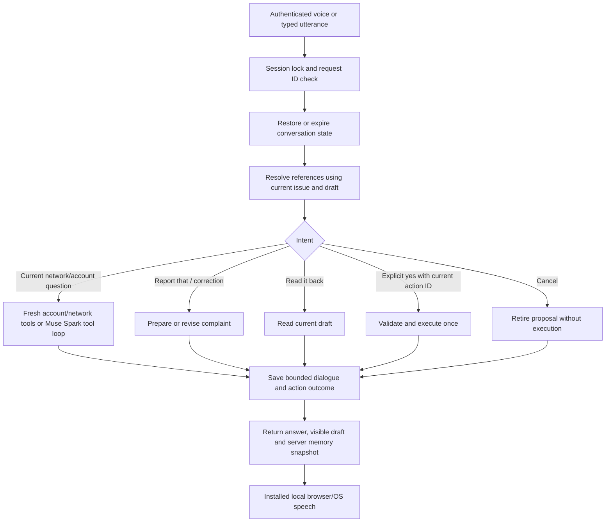

# Voice conversation memory

This is an extension of the [voice/audio redesign](VOICE_AGENT_REDESIGN.md). It keeps the Meta transcription → Muse Spark/tools → local browser/OS speech pipeline, and adds server-managed conversational state. The sections below describe the implemented workflow and its limits.

## State and lifetime

Each customer demo session owns a `VoiceConversation` in its server session. Browser-provided history is ignored by the voice endpoint; it is not the source of truth.

The server keeps:

- The latest 12 dialogue messages, including assistant replies.
- Up to 1,600 characters of extractive notes from older customer turns. These are historical statements, not instructions or verified current facts.
- The current issue: symptom, saved location and customer-provided details.
- One current unconfirmed proposal, with a unique action ID.
- The latest action and up to eight completed/cancelled action outcomes.
- A bounded cache of 16 request IDs, so retrying the same turn cannot repeat an action.

A page refresh can restore this state. Closing the assistant pauses the interaction without forgetting it. The New conversation button, or “start over,” clears context and unconfirmed proposals. Logout/new demo session and application restart do not restore the previous voice conversation. An idle timeout of 30 minutes clears memory and pending authorization on the next access. Resetting the simulator also invalidates the old conversation's proposals.

Memory is held in server RAM; it is not written to SQLite, browser storage or a long-term customer profile. There is no claim of unlimited or permanent recall.

## One turn

Simple referential turns are handled without a paid model round trip. For broader questions, Muse Spark receives the recent dialogue, bounded context notes and the current issue. Its instructions require fresh tool calls for current account/network facts; previous answers are not a cache of current service status.

## Examples

- “My data is slow at work” → check service at Work and remember the described issue.
- “Report that” → prepare the complaint using the remembered symptom/location; no submission yet.
- “Actually, change the location to home” → replace the draft and its action ID; old approvals cannot authorize the revision.
- “Actually, it's dropped calls” or “Add that it started at noon” → revise the pending report and ask again.
- “Read it back” → read the current revised draft.
- “Turn on Wi-Fi Calling” → “Actually, turn it off instead” → revise the setting proposal and require a new confirmation. After a confirmed setting change, “turn it on/off” can refer back to that setting.
- “Yes, send it” → submit the visible current proposal once.
- “Did you send it?” → use the recorded action outcome and report reference.
- “Is it still slow?” / “What about at home?” → query fresh network information for the relevant place.
- “Report that” with no known issue → ask for the symptom/location instead of inventing them.

## Isolation and confirmation

The demo still uses a shared fictional account and network. Voice dialogue and pending proposals are separated per demo session. A `ContextVar` gives the existing Care tools a session-specific pending-action dictionary and turn counter without replacing the shared account's preferences or reports. A typed assistant or another login cannot confirm a voice proposal through its default pending state.

A session lock serializes its turns and confirmations. Spoken confirmation must name the currently displayed action ID; it is handled against that exact session proposal. Editing a draft invalidates its old ID. Button confirmations and cancellations update the action memory too. Repeated request IDs return a copied cached result; using the same ID for different turn contents is rejected.

This is authorization for the demo's existing allowlisted account tools, not unrestricted computer control.

## API and files

- `GET /api/care/voice/memory`: authenticated restoration of recent messages and the current proposal.
- `DELETE /api/care/voice/memory`: clear the current session's conversation and pending proposals.
- `POST /api/care/voice/turn`: accepts text, current `action_id`, `request_id` and page. The legacy `history` field is accepted but ignored.
- Existing confirmation/cancellation routes resolve voice proposals in the caller's conversation.

Implementation: `backend/app/voice_memory.py`, session integration in `backend/app/main.py`, scoped Care tools in `backend/app/care.py`, and restoration/New conversation controls in `frontend/connect/app.js`.

## Verification

`python -m pytest tests/test_voice_memory.py tests/test_voice_agent.py -q` checks reference resolution, revisions, read-back, scope isolation, cancellation, expiration, summaries, fresh tool calls, model context, exact-once retries and visible-proposal authorization.

`node scripts/check_voice_memory_ui.js` checks the real browser/server flow on an isolated offline demo at `http://127.0.0.1:8021`. It resets demo state, submits fictional reports and uses local speech where available or Text only. Never point it at a demo whose state you want to preserve. Override `BASE_URL` as needed; demo entry requires no credentials.

Current local-speech and no-login results are in the installation verification record; older audio results apply to the earlier provider. Real microphone transcription accuracy and cloud latency remain dependent on the environment and providers.

### Historical local results (3 November 2026)

- Full application regression run: **206 passed**, 617.06 seconds.
- After the final setting-reference and non-reusable approval-ID refinements: **38 focused voice/memory Python checks passed**, 86.18 seconds.
- **14 memory browser checks passed**: report references, refresh restoration including form fields, corrections, read-back, stale approval rejection, duplicate-request protection, completed actions, referential setting changes, login isolation, clearing and logout.
- The existing **12 voice UI checks passed** and **53 support UI checks passed**. Two support-test timing races were corrected by waiting for rendered filter results and leaving a ticket before posting an unread reply; the same assertions remain in place.
- A live Muse Spark 1.3 follow-up understood a previously described issue at Work and called fresh suggestion/connection tools. The subsequent complaint, location correction, read-back and explicit submission passed.

To try the workflow, restart the local server and hard-refresh the customer page. Test “My data is slow at work” → “Report that” → “Actually, change it to home” → “Read it back” → “Yes, send it.”
